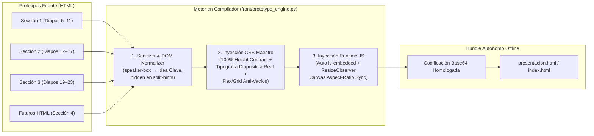

# Fase 10: Motor de Normalización de Estilos en el Compilador y Homologación Visual-Tipográfica de Diapositiva Real (Secciones 1, 2 y 3)

> **Documento de Fase:** `docs/task/fases/fase_10_motor_estilos_y_homologacion_s1_s2_s3.md`  
> **Motor nuevo en el compilador:** `front/prototype_engine.py` integrado en `back/build_deck.py`  
> **Archivos objetivo (Sección 1 — Diapos 5 a 11):** `docs/notebooklm/seccion_1/prototipos/{5_Anatomia_de_la_senal_temporal_v3,6_Era_1_La_parsimonia_lineal_v3,7_Era_2_El_puente_tabular,8_Era_3_Deep_Learning_y_Parches,9_Era_4_Modelos_Fundacionales_Zero_Shot,10_El_Cono_de_Incertidumbre_y_Prediccion_Conforme,11_Arquitectura_de_Decision_y_Cierre_Ejecutivo}.html`  
> **Archivos objetivo (Sección 2 — Diapos 12 a 17):** `docs/notebooklm/seccion_2/prototipos/{12_Caso_1_Auditoria_Iquitos,13_Datos_SENAMHI_Punchana,14_Trampa_Arboles_Meseta_vs_Diferencias,15_Benchmark_14_Modelos_Tierra_vs_Supercomputo,16_Pronostico_7_Dias_Cono_P10_P90,17_Pipeline_Codigo_Diferencias_ExtraTrees}.html`  
> **Archivos objetivo (Sección 3 — Diapos 19 a 23):** `docs/notebooklm/seccion_3/prototipos/{19_c_mo_el_agro_invent_el_forecasting,20_del_almanaque_al_sat_lite,21_f_sica_biol_gica_y_el_l_mite_algor_tmico,22_reloj_fenol_gico_del_caf,23_precisi_n_actual_y_las_tres_trampas}.html`  
> **Estado:** `[ ] Pendiente de Ejecución` (**Planificado con `/nueva-fase` tras auditoría de las 36 capturas de pantalla en 1920×1080 y 1366×768**)

---

## 1. Diagnóstico Forense Completo (Inspección de las 18 Diapositivas en `screenshots/f9_s*_{1366,1920}.png`)

Tras capturar e inspeccionar las **18 diapositivas interactivas** de las Secciones 1 (Diapos 5–11), 2 (Diapos 12–17) y 3 (Diapos 19–23) tanto en `1920×1080` como en `1366×768`, se identificaron **6 fallos estructurales y de diseño** que impiden que los prototipos se vean como verdaderas diapositivas de conferencia:

| # | Problema Detectado en las Capturas | Diapositivas Afectadas | Causa Raíz Exacta en el Código |
|---|---|---|---|
| **F1** | **Colapso de altura al 62% superior en Diapo 05 y franja negra inferior (`45–75px`) en Secciones 1 y 3.** En la Diapo 5 queda un 38% de vacío negro en la parte baja, aplastando verticalmente los dos gráficos derechos (muy anchos y chatos) y haciendo que los rótulos 3D (`Y(t)`, `T(t)`, `S(t)`) se pisen. | **05** (crítico: 38% vacío inferior) y **06, 07, 08, 09, 10, 11, 19, 20, 21, 22, 23** (franja inferior de `45–75px`) | En `5_Anatomia_de_la_senal_temporal_v3.html` **falta** `if (window.self !== window.top) document.body.classList.add('is-embedded');` en el JS. Además, en las Diapos 5–11 y 19–23 el selector `html, body` define `min-height: 100%` pero **no** `height: 100%`, por lo que `body.is-embedded { height: 100% }` no se estira al 100% del alto del iframe. |
| **F2** | **Ausencia de un motor de normalización de estilos en `back/build_deck.py`.** El compilador solo lee los bytes del HTML y los convierte a Base64 sin inyectar un sistema de diseño unificado. | **Todas (05–17 y 19–23) y futuras (Sección 4)** | `back/build_deck.py` ejecuta `base64.b64encode(path.read_bytes())` directamente. Si un HTML nuevo tiene fuentes pequeñas, olvida `is-embedded` o usa otra estructura CSS, rompe la uniformidad del deck. |
| **F3** | **Tipografía minúscula ("modo tabla web" de `10px–12px`) y hueco negro del 45% en la columna izquierda.** Las letras que explican el concepto a la izquierda son demasiado pequeñas para una exposición y quedan amontonadas arriba dejando medio panel vacío debajo. | **05, 06, 07, 08, 09, 10, 12, 13, 14, 15, 19, 20, 21, 22, 23** | `.narr-lead` usa `11px–12.5px` y `.narr-block p` / `.info-block-text` usa `10.5px–11.5px` con `.narr-blocks { justify-content: flex-start }`. Al sintetizar el texto en F9 sin escalar la fuente a tamaño de diapositiva real (`14px–17px`) ni distribuir los bloques con `flex: 1`, quedó un vacío negro en el centro-abajo de `.narrative-card`. |
| **F4** | **Desfase de formato en la Sección 2 (Diapos 12–17): teleprompter antiguo en Diapos 12–15, solape de texto en Diapo 12 y layout distinto con vacío inferior en Diapos 16–17.** | **12, 13, 14, 15, 16, 17** | Las Diapos 12–15 aún muestran `"🎙️ GUÍA DE EXPOSICIÓN (QUÉ DECIR) ~20 SEG"` de 3 líneas. En Diapo 12 el texto `"RÉCORD 38.0 °C (07-Oct-2023)"` se dibuja encima de `"38.0 °C"`. Las Diapos 16 y 17 tienen el gráfico a la izquierda y tarjetas pequeñas a la derecha con un 50% de hueco negro debajo. |
| **F5** | **Elementos residuales en Diapo 19:** cita larga de 3 líneas en `#speakerQuote` y banners `.canvas-split-hint` (`"Izquierda: 10,000 a.C... / Derecha: Presente..."`) aún visibles. | **19** | En `19_c_mo_el_agro_invent_el_forecasting.html` el HTML estático inicial conservó la cita de 42 palabras y los divs `.canvas-split-hint` sin el atributo `hidden`. |
| **F6** | **Tarjetas derechas semi-vacías con letra diminuta en Diapos 22 y 23.** En Diapo 22 las 3 cajas de diagnóstico tienen `11px` arriba y 70% de hueco negro; en Diapo 23 las 3 tarjetas de trampas tienen texto pequeño y vacío central. | **22, 23** | Los contenedores `.diag-box` (Diapo 22) y `.trap-card` (Diapo 23) se estiran con `flex: 1`, pero su contenido interno tiene fuente de `10.5px–11.5px` alineada al borde superior. |

---

## 2. Arquitectura de la Solución (Flujo del Motor de Normalización)



### 2.1. Catálogo Oficial de Diapositivas con Entrada Cinemática de Video (`🎬 Cold-Open Gate` — Sinergia F10 ↔ F11)

Cuando una diapositiva teórica compleja cuenta con un video en `video/seccion_{N}/diapo_{M}/video_{slug}/*.mp4`, **no se crea una diapositiva extra** (la numeración `01 / 30` no cambia) ni se encoge el video en una esquina:
1. **Paso 0 (Entrada Cinemática al avanzar p. ej. de Diapo 4 → Diapo 5):** Al entrar a la diapositiva, se proyecta primero a pantalla completa (`100% × 100%`, sobre fondo `#040714`) el video explicativo (`#cinematicVideoGate`).
2. **Handoff sin costura (`#040714` → Simulador Interactivo):** Al terminar el video o al pulsar `→` / `Espacio` / clic en `"Explorar Simulador →"`, el contenedor del video se desvanece suavemente (`opacity: 0`, `380ms`) sobre el mismo color `#040714` y deja al descubierto la diapositiva interactiva completa (ya rediseñada con la tipografía grande de la Fase 10).
3. **Botón `"🎬 Ver Video"` en `.flowbar`:** Queda disponible en la barra superior de la diapositiva (o con tecla `0` / `V`) para volver a proyectar la introducción cinemática en cualquier momento.

| Prioridad | Sección | Diapo | Título / Concepto Teórico | ¿Lleva Video de Entrada? | Ruta Canónica Autodescubierta por `front/prototype_engine.py` | Por Qué Necesita Entrada Cinemática (25–34 s) |
|---|---|---|---|---|---|---|
| **P1 (Listo)** | **Sección 1** (Teoría) | **Diapo 05** | **Anatomía de la Señal Temporal** ($Y_t = T_t + S_t + C_t + \varepsilon_t$) | ✅ **SÍ** *(Ya renderizado en F11)* | `video/seccion_1/diapo_5/video_anatomia_senal/anatomia_senal.mp4` | **Abre la Sección 1 (paso de Diapo 4 → 5).** Dibuja en frío los 2,557 días reales y separa las 4 fuerzas del río antes de entregar el simulador 3D. |
| — | Sección 1 | Diapo 06 | Vía 1: Modelos Analíticos (Verhulst / ARIMA) | ⚪ *No (Directo)* | — | La curva en S con techo $L$ se comprende directo en el simulador tras el video de la Diapo 5. |
| **P2** | **Sección 1** (Teoría) | **Diapo 07** | **Vía 2: El Puente Tabular** (Lags + Árboles GBDT) | ✅ **SÍ** | `video/seccion_1/diapo_7/video_puente_tabular/puente_tabular.mp4` | **Cambio de paradigma (De Ecuación a Tabla):** anima cómo una onda continua se corta en columnas (`Lag 1`, `Lag 7`) y por qué el árbol queda atrapado en una caja ortogonal incapaz de extrapolar récords. |
| — | Sección 1 | Diapo 08 | Vía 3: Deep Learning y Parches (LSTM → PatchTST) | ⚪ *No (Directo)* | — | Evita saturar con videos consecutivos; las compuertas y parches se exploran directo en el lienzo. |
| **P3** | **Sección 1** (Teoría) | **Diapo 09** | **Vía 4: Revolución Zero-Shot y Foundation Models** | ✅ **SÍ** | `video/seccion_1/diapo_9/video_zero_shot_tsfm/zero_shot_tsfm.mp4` | **Salto a la IA Fundacional (2024–2026):** visualiza miles de series globales (LOTSA 27B+) tokenizadas en parches alimentando un cerebro universal que infiere en frío sin entrenar localmente. |
| **P4** | **Sección 1** (Teoría) | **Diapo 10** | **El Cono de Incertidumbre y Predicción Conforme (SCP)** | ✅ **SÍ** | `video/seccion_1/diapo_10/video_cono_incertidumbre/cono_incertidumbre.mp4` | **Tesis central de la charla:** muestra cómo el pronóstico puntual ($\hat{y}_t$) se rompe ante el caos de Lyapunov y cómo las bandas empíricas P10–P90 protegen la decisión operativa. |
| — | Sección 1 | Diapo 11 | Guía Práctica: Árbol de Decisión (Las 4 Vías) | ⚪ *No (Directo)* | — | Mapa comparativo de cierre del Acto 1; debe abrir directo en las 4 columnas. |
| **P5** | **Sección 3** (Teoría Agro) | **Diapo 19** | **Cómo el Agro Inventó el Forecasting (10,000 a.C. → Hoy)** | ✅ **SÍ** | `video/seccion_3/diapo_19/video_agro_origen/agro_origen.mp4` | **Abre la Sección 3 (paso de Diapo 18 → 19):** viaje cinemático desde los andenes y cabañuelas ancestrales hasta la malla satelital 3D y la biología de la planta. |
| — | Sección 3 | Diapo 20 | Del Almanaque al Satélite (5 Escalones) | ⚪ *No (Directo)* | — | Línea de tiempo interactiva directa tras el video de apertura de la Diapo 19. |
| **P6** | **Sección 3** (Teoría Agro) | **Diapo 21** | **Física Biológica y el Límite Algorítmico** ($\tau = 6\text{–}8\text{m}$, VPD) | ✅ **SÍ** | `video/seccion_3/diapo_21/video_fisica_biologica/fisica_biologica.mp4` | **Núcleo biofísico del agro:** muestra un golpe de calor de 33 °C abortando la flor en octubre mientras el follaje sigue verde, cobrando la factura 8 meses después en la cosecha. |
| — | Sección 3 | Diapos 22–23 | Reloj Fenológico y Las 3 Trampas | ⚪ *No (Directo)* | — | El reloj botánico circular y el stack 3D de trampas ya son altamente gráficos e interactivos. |
| **P7 (Opcional)** | **Sección 5** (Cierre) | **Diapo 29** | **Conclusiones y Lecciones Aprendidas** (Paso de 28 → 29) | 🟡 **Opcional de Cierre** | `video/seccion_5/diapo_29/video_sintesis_cierre/sintesis_cierre.mp4` | **Manifiesto final (25 s):** recapitula visualmente los 2 casos (Iquitos 2,557d + Jaén 24 campañas) antes de fijar las 3 tarjetas de conclusiones. |

---

## [ ] Fase 10 — Motor de Normalización de Estilos en el Compilador y Homologación Visual-Tipográfica de Diapositiva Real (Secciones 1, 2 y 3)

- **Objetivo:** Transformar las 18 diapositivas interactivas de las Secciones 1, 2 y 3 en **diapositivas reales de auditorio** (tipografía amplia y legible a distancia, ocupación exacta del 100% del alto sin franjas ni huecos negros, lienzos derechos con relación de aspecto armónica que se autoajustan a cualquier laptop, soporte automático de **Entrada Cinemática por Video (`#cinematicVideoGate`)** en coordinación con la Fase 11, y formato 100% unificado) mediante la creación de un **Motor de Normalización de Prototipos (`front/prototype_engine.py`)** dentro del compilador `back/build_deck.py` y el refinamiento de los 18 archivos HTML.
- **Entregable global:** Módulo `front/prototype_engine.py` conectado a `back/build_deck.py` (con autodescubrimiento de videos en `video/seccion_{N}/diapo_{M}/`), los 18 prototipos HTML de las Secciones 1, 2 y 3 homologados, script de auditoría `scripts/audit_f10_layout_typography.py` en verde y bundles `presentacion.html` e `index.html` verificados con 36 capturas en `1920×1080` y `1366×768`.
- **AC global de la Fase:**
  - [ ] El motor `front/prototype_engine.py` procesa e inyecta automáticamente las reglas de altura 100%, escala tipográfica de presentación, distribución anti-vacíos, `ResizeObserver` universal y el contenedor `#cinematicVideoGate` (cuando existe un `.mp4` en `video/seccion_{N}/diapo_{M}/`) en todos los HTMLs embebidos por `back/build_deck.py`.
  - [ ] Al avanzar de la Diapo 4 a la Diapo 5 (y en cualquier diapositiva con video en `video/`), se presenta primero el video cinemático a pantalla completa sobre fondo `#040714` dentro de la misma diapositiva y, al terminar o pulsar `→`, transiciona sin costura al simulador interactivo.
  - [ ] El 100% de las 18 diapositivas (`5–11`, `12–17`, `19–23`) ocupa el 100% de la altura del contenedor (`#slideFrame.clientHeight >= window.innerHeight * 0.98`), eliminando el colapso del 38% en la Diapo 5 y las franjas inferiores en las demás.
  - [ ] La tipografía de la columna explicativa alcanza escala real de diapositiva (`narr-title` $\ge 19\text{px}$, `narr-lead` $\ge 14\text{px}$, cuerpo de bloques $\ge 13\text{px}$ en 1080p) y los bloques se distribuyen sin huecos negros vacíos ni barras de scroll verticales (`scrollHeight <= clientHeight + 2`).
  - [ ] Las 18 diapositivas de las Secciones 1, 2 y 3 comparten el mismo estándar de cabecera (`.topbar`), barra de 4 etapas (`.flowbar`), tarjeta narrativa y píldora `💡 Idea Clave` de 1 línea, con cero solapamientos en gráficos Canvas/DOM.
- **Tests de la Fase:**
  - **Test Unitario:** `scripts/audit_f10_layout_typography.py` que verifica el procesamiento de `front/prototype_engine.py`, la inyección de `#cinematicVideoGate` en la Diapo 5, la ausencia de `"GUÍA DE EXPOSICIÓN"` en los 18 prototipos y las reglas CSS/JS inyectadas.
  - **Test de Simulación de Usuario:** Auditoría automatizada en Chromium headless a `1920×1080` y `1366×768` midiendo por DOM (`getBoundingClientRect` y `getComputedStyle`) altura al 100%, tamaños de fuente mínimos, handoff del video de entrada en Diapo 5, cero scrollbars y generando las 36 capturas `screenshots/f10_s*_{1366,1920}.png`.

---

### [ ] SF10.1 — Creación del Motor de Normalización, Entrada Cinemática de Video e Inyección de Estilos en el Compilador (`front/prototype_engine.py` + `back/build_deck.py`)

- **Objetivo:** Construir un pipeline de preprocesamiento HTML/CSS/JS en el motor de compilación para que `back/build_deck.py` no incruste los archivos HTML en crudo, sino que aplique automáticamente un tema maestro de diapositiva real, normalice componentes heredados, inyecte la **Entrada Cinemática (`#cinematicVideoGate`)** cuando exista un video en `video/seccion_{N}/diapo_{M}/`, y garantice adaptabilidad responsiva en cualquier resolución de laptop o proyector.
- **Entregable:** `front/prototype_engine.py` creado e integrado en `back/build_deck.py`.
- **AC de la Sub fase:**
  - [ ] `front/prototype_engine.py` expone `normalize_prototype_html(html_str: str, slide_num: int, section_num: int, video_rel_path: str | None = None) -> str` y `load_prototype_b64(path: Path, slide_num: int, section_num: int) -> str`.
  - [ ] Si existe `video/seccion_{N}/diapo_{M}/**/*.mp4`, el motor inyecta automáticamente `#cinematicVideoGate` y el botón `"🎬 Intro"` en `.flowbar`, permitiendo ver primero el video al entrar a la diapositiva y pasar luego al simulador con `→` sin cambiar de diapositiva.
  - [ ] `back/build_deck.py` utiliza `load_prototype_b64()` para los 18 prototipos actuales y soporta descubrimiento automático para futuras diapositivas HTML y futuros videos de la Fase 11.
- **Tests de la Sub fase:**
  - **Test Unitario:** Ejecutar test de transformación sobre un HTML de prueba verificando que inyecta `#deck-engine-override-css`, `#deck-engine-runtime-js` y `#cinematicVideoGate` cuando se provee un video.
  - **Test de Simulación de Usuario:** Compilar el deck con `back/build_deck.py` y verificar en Chromium que todos los iframes contienen el estilo y runtime del motor activo, y que la Diapo 5 cuenta con la entrada cinemática conectada a `anatomia_senal.mp4`.

#### [ ] T10.1.1 — Implementar `front/prototype_engine.py` con CSS Maestro de Diapositiva Real, Normalizador DOM y Runtime Responsivo
- **Objetivo de la Tarea:** Crear el módulo `front/prototype_engine.py` que inyecta la hoja de estilos de alto impacto (`#deck-engine-override-css`), limpia patrones obsoletos en el HTML y añade el observador de redimensionamiento de lienzos (`#deck-engine-runtime-js`).
- **Entregable:** Archivo `front/prototype_engine.py`.

> **🧠 Explicación:** Hasta ahora cada prototipo HTML en `docs/notebooklm/seccion_{1,2,3}/prototipos/` definía sus propias reglas de tamaño de fuente (`10px–12px`) y de altura (`min-height: 100%` en lugar de `height: 100%`). Cuando `back/build_deck.py` los convertía directamente a Base64, cualquier omisión (como olvidar `document.body.classList.add('is-embedded')` en la Diapo 5) rompía la visualización en la presentación. Al centralizar un **Motor de Normalización (`front/prototype_engine.py`)**, el compilador garantiza por contrato que todo prototipo HTML:
> 1. Ocupe exactamente el `100%` del ancho y alto del iframe (`html, body, #slideFrame { height: 100% !important; }`).
> 2. Escale los textos explicativos a **tamaño real de diapositiva de conferencia** (`clamp()`) y distribuya las cajas de la columna izquierda con `flex: 1; justify-content: space-evenly` para erradicar los huecos negros vacíos.
> 3. Ejecute un `ResizeObserver` que recalibra la relación alto/ancho de todos los `<canvas>` automáticamente al cambiar de resolución de laptop.

> **💡 Cómo hacerlo (ejemplo):**
> ```python
> # front/prototype_engine.py
> import base64
> import re
> from pathlib import Path
>
> ENGINE_OVERRIDE_CSS = """
> <style id="deck-engine-override-css">
> /* === MOTOR DE NORMALIZACIÓN VISUAL Y TIPOGRÁFICA DE DIAPOSITIVAS (F10) === */
> html, body {
>   width: 100% !important;
>   height: 100% !important;
>   min-height: 100% !important;
>   max-height: 100% !important;
>   margin: 0 !important;
>   padding: 0 !important;
>   overflow: hidden !important;
> }
> body.is-embedded {
>   display: flex !important;
>   flex-direction: column !important;
>   width: 100% !important;
>   height: 100% !important;
> }
> body.is-embedded #slideFrame {
>   width: 100% !important;
>   height: 100% !important;
>   min-height: 100% !important;
>   max-height: 100% !important;
>   aspect-ratio: auto !important;
>   flex: 1 1 100% !important;
>   display: grid !important;
>   grid-template-rows: auto auto minmax(0, 1fr) auto !important;
>   gap: clamp(8px, 1.1vh, 14px) !important;
>   padding: clamp(10px, 1.4vh, 18px) clamp(14px, 1.6vw, 24px) clamp(8px, 1vh, 12px) !important;
>   border: none !important;
>   border-radius: 0 !important;
>   box-shadow: none !important;
> }
>
> /* CABECERA Y BARRA DE PROCESO UNIFICADAS */
> .eyebrow {
>   font-size: clamp(10.5px, 0.8vw, 12.5px) !important;
>   letter-spacing: 0.12em !important;
> }
> h1 {
>   font-size: clamp(20px, 1.75vw, 28px) !important;
>   line-height: 1.12 !important;
> }
> .proc-year, .step-title {
>   font-size: clamp(12px, 0.92vw, 14.5px) !important;
>   line-height: 1.18 !important;
> }
> .proc-sub, .step-sub {
>   font-size: clamp(10px, 0.75vw, 12px) !important;
> }
>
> /* PROPORCIÓN ARMÓNICA 40/60 Y ALTURA COMPLETA DEL WORKSPACE */
> .workspace, .main-stage {
>   display: grid !important;
>   grid-template-columns: minmax(340px, 0.40fr) minmax(0, 0.60fr) !important;
>   gap: clamp(12px, 1.2vw, 18px) !important;
>   height: 100% !important;
>   min-height: 0 !important;
>   align-items: stretch !important;
> }
>
> /* COLUMNA EXPLICATIVA: ESCALA DE DIAPOSITIVA REAL Y CERO HUECOS NEGROS */
> .left-column, .narrative-card {
>   display: flex !important;
>   flex-direction: column !important;
>   justify-content: space-between !important;
>   height: 100% !important;
>   min-height: 0 !important;
>   padding: clamp(12px, 1.5vh, 20px) clamp(14px, 1.3vw, 20px) !important;
>   gap: clamp(8px, 1.1vh, 14px) !important;
>   overflow: hidden !important;
> }
> .narr-top, .narr-header {
>   display: flex !important;
>   flex-direction: column !important;
>   gap: clamp(4px, 0.6vh, 8px) !important;
>   flex-shrink: 0 !important;
> }
> .stage-tag, .narr-tag, .act-badge {
>   font-size: clamp(10.5px, 0.78vw, 12px) !important;
>   padding: 4px 10px !important;
> }
> .narr-title, .narrative-card h2, .left-column h2 {
>   font-size: clamp(17.5px, 1.42vw, 22.5px) !important;
>   line-height: 1.2 !important;
>   font-weight: 700 !important;
>   color: #f8fbff !important;
>   margin: 0 !important;
> }
> .narr-lead, .narrative-card .lead {
>   font-size: clamp(13px, 1.02vw, 15.8px) !important;
>   line-height: 1.42 !important;
>   color: #d8e6f8 !important;
>   margin: 0 !important;
> }
> .narr-blocks, .layers-strip {
>   flex: 1 1 auto !important;
>   display: flex !important;
>   flex-direction: column !important;
>   justify-content: space-evenly !important;
>   gap: clamp(7px, 1vh, 12px) !important;
>   min-height: 0 !important;
> }
> .narr-block, .info-block {
>   flex: 1 1 auto !important;
>   display: flex !important;
>   flex-direction: column !important;
>   justify-content: center !important;
>   padding: clamp(9px, 1.2vh, 14px) clamp(11px, 1vw, 15px) !important;
>   border-radius: 10px !important;
> }
> .narr-block-title, .info-block-label {
>   font-size: clamp(10.5px, 0.8vw, 12.5px) !important;
>   margin-bottom: 4px !important;
>   letter-spacing: 0.08em !important;
> }
> .narr-block p, .narr-block-body, .info-block-text {
>   font-size: clamp(12.5px, 0.96vw, 15px) !important;
>   line-height: 1.38 !important;
>   color: #e2edf8 !important;
>   margin: 0 !important;
> }
> .layer-list {
>   flex: 1 1 auto !important;
>   display: flex !important;
>   flex-direction: column !important;
>   justify-content: space-between !important;
>   gap: clamp(5px, 0.7vh, 9px) !important;
> }
> .layer-row {
>   flex: 1 1 auto !important;
>   padding: clamp(6px, 0.85vh, 10px) 10px !important;
> }
> .layer-name {
>   font-size: clamp(12.5px, 0.94vw, 14.5px) !important;
> }
> .layer-desc {
>   font-size: clamp(11px, 0.84vw, 13px) !important;
>   color: #cbd5e1 !important;
> }
> .formula-bar {
>   padding: clamp(8px, 1vh, 12px) 13px !important;
>   flex-shrink: 0 !important;
> }
> .formula-lhs {
>   font-size: clamp(12.5px, 0.95vw, 14.8px) !important;
> }
> .executive-takeaway, .speaker-box {
>   display: flex !important;
>   align-items: center !important;
>   gap: 8px !important;
>   padding: clamp(8px, 1vh, 12px) 13px !important;
>   border-radius: 9px !important;
>   font-size: clamp(12px, 0.92vw, 14.2px) !important;
>   line-height: 1.32 !important;
>   margin-top: 0 !important;
>   flex-shrink: 0 !important;
> }
>
> /* COLUMNA DERECHA: LIENZOS AUTO-AJUSTABLES AL 100% DE LA ALTURA */
> .sim-card, .visual-column {
>   height: 100% !important;
>   min-height: 0 !important;
> }
> .canvas-wrap, .chart-wrap {
>   flex: 1 1 0% !important;
>   min-height: 0 !important;
>   height: 100% !important;
> }
> </style>
> """
> ```

- **AC de la Tarea:**
  - [ ] `front/prototype_engine.py` existe, es importable desde `back/build_deck.py` y aplica `ENGINE_OVERRIDE_CSS` y `ENGINE_RUNTIME_JS` a cualquier prototipo HTML.
  - [ ] El runtime JS inyectado añade automáticamente `document.body.classList.add('is-embedded')` y dispara el redimensionado de todos los `<canvas>` al montar y al cambiar el tamaño de ventana.
- **Tests de la Tarea:**
  - **Test Unitario:** `.venv/bin/python -c "from front.prototype_engine import normalize_prototype_html; out = normalize_prototype_html('<html><head></head><body></body></html>', 5, 1); assert 'deck-engine-override-css' in out"`.
  - **Test de Simulación de Usuario:** Compilar `presentacion.html` y verificar en Chromium que `presentacion.html#5` ocupa el 100% de la pantalla sin el vacío inferior del 38%.

##### [ ] A10.1.1.1 — Crear `front/prototype_engine.py` con el motor de inyección CSS/JS y normalización DOM
- **Objetivo:** Implementar el archivo `front/prototype_engine.py` con las reglas de estilo unificadas y el observador de aspecto para lienzos Canvas.
- **Input:** Especificación de estilos de las Secciones 1, 2 y 3.
- **Output:** `front/prototype_engine.py`.
- **Proceso:**
  1. Escribir `ENGINE_OVERRIDE_CSS` con el contrato de altura `100%`, tipografía fluida `clamp()` de diapositiva real y distribución flex/grid sin huecos vacíos.
  2. Escribir `ENGINE_RUNTIME_JS` que asegure `is-embedded`, normalice `.speaker-box` heredados y sincronice el tamaño de los `<canvas>` mediante `ResizeObserver`.
  3. Implementar `normalize_prototype_html()` y `load_prototype_b64()`.
- **Tests:**
  - **Test Unitario:** Importar y ejecutar `normalize_prototype_html` validando la presencia de las etiquetas `<style id="deck-engine-override-css">` y `<script id="deck-engine-runtime-js">`.
  - **Test de Simulación de Usuario:** Verificar el renderizado de una diapositiva procesada por el motor en Chromium headless.

#### [ ] T10.1.2 — Conectar `front/prototype_engine.py` en `back/build_deck.py` con Soporte Automático Multi-Sección
- **Objetivo de la Tarea:** Reemplazar todas las lecturas crudas `base64.b64encode(path.read_bytes())` en `back/build_deck.py` por llamadas a `load_prototype_b64(path, slide_num, section_num)` para las Secciones 1, 2, 3 y futuras.
- **Entregable:** `back/build_deck.py` actualizado.

> **🧠 Explicación:** Si `back/build_deck.py` sigue leyendo bytes crudos con `read_bytes()`, cualquier prototipo nuevo que se agregue en el futuro volverá a verse distinto o sufrirá problemas de escala. Al enrutar el 100% de las cargas por `load_prototype_b64()`, el motor de compilación actúa como un verdadero **pipeline de post-procesado visual**.

> **💡 Cómo hacerlo (ejemplo):**
> ```python
> # En back/build_deck.py
> from front.prototype_engine import load_prototype_b64
>
> b64_sim_html = load_prototype_b64(sim_path, slide_num=5, section_num=1)
> b64_era1_html = load_prototype_b64(era1_path, slide_num=6, section_num=1)
> # ... igual para 7..11 (Sección 1), 12..17 (Sección 2) y 19..23 (Sección 3)
> ```

- **AC de la Tarea:**
  - [ ] Ningún prototipo HTML en `back/build_deck.py` se codifica en Base64 sin pasar por `load_prototype_b64()`.
  - [ ] `.venv/bin/python back/build_deck.py` compila con código `0` generando `presentacion.html` e `index.html`.
- **Tests de la Tarea:**
  - **Test Unitario:** Verificar con `grep -c "load_prototype_b64" back/build_deck.py` que los 18 prototipos usan el motor.
  - **Test de Simulación de Usuario:** Cargar `presentacion.html` en navegador headless y comprobar que las 18 diapositivas interactivas tienen inyectado `#deck-engine-override-css`.

##### [ ] A10.1.2.1 — Refactorizar `back/build_deck.py` para procesar los 18 prototipos con `load_prototype_b64`
- **Objetivo:** Conectar el motor de estilos al compilador principal del deck.
- **Input:** `back/build_deck.py` y `front/prototype_engine.py`.
- **Output:** `back/build_deck.py` actualizado.
- **Proceso:**
  1. Importar `load_prototype_b64` desde `front.prototype_engine`.
  2. Sustituir las 18 codificaciones `base64.b64encode(...)` por `load_prototype_b64(...)`.
  3. Ejecutar `back/build_deck.py` y verificar la compilación.
- **Tests:**
  - **Test Unitario:** `.venv/bin/python back/build_deck.py` retorna `0`.
  - **Test de Simulación de Usuario:** Inspeccionar el iframe de la Diapo 5 en `presentacion.html` confirmando que tiene la clase `is-embedded` y ocupa el 100% del alto.

#### [ ] T10.1.3 — Inyección Automática de Entrada Cinemática de Video (`#cinematicVideoGate`) y Handoff Sin Costura (`#040714`) en `front/prototype_engine.py`
- **Objetivo de la Tarea:** Dotar a `front/prototype_engine.py` de detección e inyección automática de videos de apertura (`video/seccion_{section_num}/diapo_{slide_num}/video_*/<slug>.mp4`) como **Etapa 0 (`#cinematicVideoGate`) dentro de la misma diapositiva**, de modo que al avanzar desde la diapositiva $M-1 \to M$ se reproduzca primero el video a pantalla completa sobre fondo `#040714` y luego haga transición suave (`fade-out` de `0.45s`) hacia la diapositiva interactiva homologada sin alterar la numeración de las 30 diapositivas.
- **Entregable:** Función `discover_slide_video(section_num, slide_num)` e inyección de `#cinematicVideoGate` + botón `"🎬 Intro"` en `front/prototype_engine.py`.

> **🧠 Explicación:** Cuando el ponente pasa de la **Diapo 4 a la Diapo 5** (o en cualquiera de las diapositivas teóricas identificadas: **05, 07, 09, 10** en Sección 1; **19, 21** en Sección 3; **29** en Sección 5), el público no debe recibir de golpe un tablero lleno de controles y ecuaciones. En su lugar, la **propia Diapo $M$** se abre con una **Entrada Cinemática (`#cinematicVideoGate`)** sobre el mismo color exacto de fondo (`#040714`) que presenta visualmente la intuición en 25–30 segundos. Al terminar el video (o al pulsar `→` / `Espacio` / clic en `"Saltar a Diapositiva Interactiva →"`), la compuerta de video se desvanece suavemente (`opacity: 0`) revelando el simulador interactivo en su Etapa 1, y deja un botón `"🎬 Intro"` en la `.flowbar` por si el ponente desea volver a proyectar el video en cualquier momento.

> **💡 Cómo hacerlo (ejemplo):**
> ```python
> # En front/prototype_engine.py
> def discover_slide_video(root_dir: Path, section_num: int, slide_num: int) -> Path | None:
>     """Busca el MP4 canónico en video/seccion_{N}/diapo_{M}/video_*/<nombre>.mp4."""
>     diapo_dir = root_dir / "video" / f"seccion_{section_num}" / f"diapo_{slide_num}"
>     if not diapo_dir.exists():
>         return None
>     # Priorizar el MP4 principal (sin sufijos _v1, _v2, _v3)
>     candidates = sorted(
>         p for p in diapo_dir.glob("video_*/*.mp4")
>         if not re.search(r"_v\d+", p.stem)
>     )
>     return candidates[0] if candidates else None
> ```
> ```html
> <!-- Overlay inyectado automáticamente cuando existe video para (section_num, slide_num) -->
> <div id="cinematicVideoGate" class="cinematic-video-gate is-active" data-slide-video="true">
>   <video id="cinematicIntroPlayer" src="video/seccion_1/diapo_5/video_anatomia_senal/anatomia_senal.mp4"
>          preload="auto" muted playsinline></video>
>   <div class="cinematic-hud">
>     <span class="cinematic-badge">🎬 INTRO VISUAL · DIAPO 05</span>
>     <button type="button" id="btnSkipCinematic" class="cinematic-skip-btn">
>       Pasar al Simulador Interactivo →
>     </button>
>   </div>
> </div>
> ```

> **⚠️ Nota Técnica Crítica (`data:text/html;base64` vs. Ruta Relativa del MP4):**
> Como los prototipos se embeben en `presentacion.html` mediante `<iframe src="data:text/html;base64,...">`, un `<video src="video/...">` relativo dentro de un `data:` URI no tiene origen de directorio por defecto. Para que el MP4 cargue instantáneamente sin inflar el Base64 ni fallar por ruta:
> 1. **Opción recomendada (Overlay en `<section class="slide" data-index="M">` + mensaje `replay_intro` desde `.flowbar`):** `front/prototype_engine.py` provee `render_slide_video_gate(section_num, slide_num, bg_hex)` que se inyecta directamente en el `<section class="slide" data-index="M">` de `front/deck_slides_p1.py` / `p2.py` (donde `src="video/seccion_1/diapo_5/video_anatomia_senal/anatomia_senal.mp4"` resuelve de forma nativa junto a `presentacion.html`, y además funciona igual para diapositivas nativas como la **Diapo 29**).
> 2. **Sincronización con `.flowbar`:** Dentro del iframe, `normalize_prototype_html()` inyecta el botón `"🎬 Intro"` en la `.flowbar`, el cual envía `window.parent.postMessage({ type: 'deck_replay_video', slide: M }, '*')` para volver a abrir `#cinematicVideoGate` cuando el ponente lo desee.

- **AC de la Tarea:**
  - [ ] `discover_slide_video(root, 1, 5)` detecta automáticamente `video/seccion_1/diapo_5/video_anatomia_senal/anatomia_senal.mp4` (ignorando versiones `_v1`, `_v2`, `_v3`).
  - [ ] Cuando existe un video para `(section_num, slide_num)`, se inyecta `#cinematicVideoGate` con el color exacto de la sección (`#040714` en Sección 1, `#040812` en Sección 3, `#03050F` en Sección 5) y el botón `"🎬 Intro"` al inicio de `.flowbar` / `.stage-nav`.
  - [ ] Al avanzar desde la diapositiva anterior ($M-1 \to M$), el video se reproduce automáticamente; al finalizar (`ended`) o al presionar `ArrowRight` / clic en `"Pasar al Simulador Interactivo →"`, `#cinematicVideoGate` hace `fade-out` (`0.45s`) y entrega el control a la Etapa 1 de la diapositiva sin cambiar de número de diapositiva en el deck.
- **Tests de la Tarea:**
  - **Test Unitario:** Verificar con Python que `discover_slide_video(ROOT, 1, 5)` retorna `video/seccion_1/diapo_5/video_anatomia_senal/anatomia_senal.mp4` y que la Diapo 5 compilada contiene `id="cinematicVideoGate"`.
  - **Test de Simulación de Usuario:** Navegar en Chromium desde la Diapo 4 a la Diapo 5, verificar que `#cinematicVideoGate` reproduce `anatomia_senal.mp4` (`readyState >= 2`) y que al pulsar `ArrowRight` se muestra la Diapo 5 interactiva a pantalla completa.

##### [ ] A10.1.3.1 — Implementar `discover_slide_video()` e inyección de `#cinematicVideoGate` en `front/prototype_engine.py` y el deck
- **Objetivo:** Integrar el soporte automático de Entrada Cinemática (`F10 ↔ F11`) evitando el problema de rutas relativas en `data:` URIs.
- **Input:** Estructura `video/seccion_{N}/diapo_{M}/video_*/`, `front/prototype_engine.py`, `front/deck_slides_p1.py` y `front/deck_slides_p2.py`.
- **Output:** `front/prototype_engine.py` y compuerta `#cinematicVideoGate` operativa en `presentacion.html`.
- **Proceso:**
  1. Implementar `discover_slide_video(root_dir, section_num, slide_num)` filtrando archivos de respaldo (`_v1`, `_v2`, `_v3`).
  2. Generar la compuerta `#cinematicVideoGate` en la diapositiva correspondiente (con fondo `#040714` / `#040812` / `#03050F`, transición `opacity 0.45s cubic-bezier(0.22, 1, 0.36, 1)` y HUD inferior derecho) y añadir el botón `"🎬 Intro"` en `.flowbar` vía `postMessage`.
  3. Interceptar la primera pulsación de `ArrowRight` / `Space` cuando `#cinematicVideoGate.is-active` está visible para cerrar el video y mostrar la Etapa 1 del simulador antes de avanzar a las etapas `2..4`.
- **Tests:**
  - **Test Unitario:** Comprobar que la Diapo 5 compilada incluye `#cinematicVideoGate` apuntando a `video/seccion_1/diapo_5/video_anatomia_senal/anatomia_senal.mp4`.
  - **Test de Simulación de Usuario:** Verificar en Chromium que el `<video>` carga sin error de red/ruta y realiza el handoff visual sin parpadeo (`#040714`) hacia el simulador de la Diapo 5.

---

### [ ] SF10.2 — Reparación de Altura, Proporción 2D/3D y Escalado Tipográfico en la Sección 1 (Diapositivas 5 a 11)

- **Objetivo:** Corregir de raíz la Diapositiva 5 (que en la imagen del usuario aparecía aplastada en el 62% superior con textos 3D superpuestos y letra minúscula) y homologar las Diapositivas 6 a 11 para que luzcan como diapositivas reales de conferencia, sin huecos negros en la columna izquierda y con gráficos amplios y legibles.
- **Entregable:** Los 7 prototipos en `docs/notebooklm/seccion_1/prototipos/` (`5` a `11`) actualizados.
- **AC de la Sub fase:**
  - [ ] La Diapo 5 ocupa el 100% del alto de la pantalla, sus dos paneles derechos (`Monitor 2D` y `Descomposición 3D`) tienen una proporción vertical equilibrada (`42% / 58%`) y las 5 etiquetas de las placas 3D jamás se superponen.
  - [ ] Las Diapos 5 a 10 muestran tipografía amplia en la columna izquierda (`narr-title` $\ge 19\text{px}$, `narr-lead` $\ge 14\text{px}$, bloques $\ge 13\text{px}$) ocupando el 100% de la tarjeta sin huecos negros vacíos.
  - [ ] La Diapo 11 distribuye sus 4 columnas ocupando el 100% de la altura con barras y textos legibles a distancia.
- **Tests de la Sub fase:**
  - **Test Unitario:** Verificar en los 7 archivos HTML de la Sección 1 la presencia de `html, body { width: 100%; height: 100%; }` y `is-embedded`.
  - **Test de Simulación de Usuario:** Capturas en Chromium a `1920×1080` y `1366×768` de las Diapos 5 a 11 confirmando cero vacíos inferiores y cero solapamientos 3D en la Diapo 5.

#### [ ] T10.2.1 — Diapo 05 (`5_Anatomia_de_la_senal_temporal_v3.html`): Corrección del Colapso Vertical (62% → 100%), Proporción 2D/3D y Separación de Etiquetas 3D
- **Objetivo de la Tarea:** Hacer que la Diapo 5 llene el 100% de la altura de la pantalla, equilibrar la altura de sus dos gráficos derechos (`Monitor 2D` y `Descomposición 3D`), evitar que los rótulos de las 5 placas 3D se pisen entre sí y agrandar las letras del panel izquierdo.
- **Entregable:** `docs/notebooklm/seccion_1/prototipos/5_Anatomia_de_la_senal_temporal_v3.html` corregido.

> **🧠 Explicación:** En la captura compartida por el usuario (`/tmp/orca-paste-...png`), la Diapo 5 se veía mal por tres razones combinadas:
> 1. **Faltaba `if (window.self !== window.top) document.body.classList.add('is-embedded');`** en su script y `height: 100%` en `html`, por lo que `#slideFrame` mantenía un ancho fijo con altura reducida, dejando el 38% inferior de la diapositiva completamente negro.
> 2. Al quedar aplastada la altura total, `.visual-column` comprimía el `Monitor 2D` y el `Canvas 3D` en franjas muy anchas pero de apenas `110px–150px` de alto, haciendo que las 5 placas 3D (`Y(t)`, `T(t)`, `S(t)`, `C(t)`, `ε(t)`) quedaran pegadas y sus textos se encimaran unos sobre otros.
> 3. Las 5 tarjetas de capas (`.layer-row`) tenían letra de `10px–11px`.
> Al activar el `100%` de altura real, dar `grid-template-rows: minmax(0, 0.42fr) minmax(0, 0.58fr)` a `.visual-column`, escalar la separación vertical 3D con respecto a `H` y aplicar un algoritmo de separación mínima vertical (`minGapY = 18px`) con pastillas oscuras detrás de cada etiqueta 3D, el gráfico derecho cobra una presencia tridimensional impecable y la columna izquierda se lee con claridad total.

> **💡 Cómo hacerlo (ejemplo):**
> ```javascript
> // En draw3D(data) de 5_Anatomia_de_la_senal_temporal_v3.html:
> // 1. Escalar la separación vertical de las 5 placas proporcionalmente al alto real H del canvas:
> const spread = (state.layerGap / 48) * Math.max(1.15, H / 240);
> // 2. Al dibujar las etiquetas de las 5 placas (Y, T, S, C, E), ordenar por coordenada Y en pantalla
> //    y aplicar separación mínima anti-colisión (18px) con fondo tipo pastilla (roundRect):
> const labelItems = slabs.map(slab => ({
>   text: `${slab.sym} ${slab.name.toUpperCase()}`,
>   color: slab.color,
>   x: slab.labelPt.x + 10,
>   y: slab.labelPt.y,
>   isSelected: state.selected === slab.key
> })).sort((a, b) => a.y - b.y);
>
> for (let i = 1; i < labelItems.length; i++) {
>   if (labelItems[i].y - labelItems[i - 1].y < 18) {
>     labelItems[i].y = labelItems[i - 1].y + 18;
>   }
> }
> labelItems.forEach(item => {
>   ctx.font = `${item.isSelected ? '700' : '600'} 11.5px "JetBrains Mono", monospace`;
>   const tw = ctx.measureText(item.text).width;
>   ctx.fillStyle = 'rgba(4, 9, 22, 0.88)';
>   ctx.strokeStyle = item.color;
>   ctx.lineWidth = item.isSelected ? 1.5 : 0.9;
>   ctx.beginPath();
>   ctx.roundRect(item.x - 5, item.y - 10, tw + 10, 16, 4);
>   ctx.fill();
>   ctx.stroke();
>   ctx.fillStyle = item.color;
>   ctx.fillText(item.text, item.x, item.y + 2);
> });
> ```

- **AC de la Tarea:**
  - [ ] `5_Anatomia_de_la_senal_temporal_v3.html` incluye `if (window.self !== window.top) document.body.classList.add('is-embedded');` y `html, body { height: 100%; }`.
  - [ ] En `1920×1080` y `1366×768`, la Diapo 5 llena el 100% de la altura del visor sin el vacío negro inferior del 38%.
  - [ ] Las 5 etiquetas del gráfico 3D (`Y(t)`, `T(t)`, `S(t)`, `C(t)`, `ε(t)`) tienen pastilla de fondo oscuro y separación mínima de `18px`, sin pisarse nunca.
- **Tests de la Tarea:**
  - **Test Unitario:** Verificar con script que `is-embedded` y el algoritmo anti-colisión `labelItems` existen en `5_Anatomia_de_la_senal_temporal_v3.html`.
  - **Test de Simulación de Usuario:** Capturar `presentacion.html#5` a `1920×1080` y `1366×768` y confirmar visualmente que llena toda la pantalla y los rótulos 3D se ven separados y legibles.

##### [ ] A10.2.1.1 — Corregir `is-embedded`, proporciones `.visual-column`, tipografía de capas y anti-colisión de etiquetas 3D en Diapo 05
- **Objetivo:** Reparar completamente el layout, la tipografía y el renderizado 2D/3D de `5_Anatomia_de_la_senal_temporal_v3.html`.
- **Input:** `docs/notebooklm/seccion_1/prototipos/5_Anatomia_de_la_senal_temporal_v3.html`.
- **Output:** `5_Anatomia_de_la_senal_temporal_v3.html` actualizado.
- **Proceso:**
  1. Añadir `height: 100%` en `html, body` y el detector `if (window.self !== window.top) document.body.classList.add('is-embedded');` al inicio del script.
  2. Ajustar `.visual-column` a `grid-template-rows: minmax(0, 0.42fr) minmax(0, 0.58fr)` y subir los tamaños de fuente de `.narr-title`, `.narr-lead`, `.layer-name` y `.layer-desc`.
  3. En `draw3D()`, escalar la proyección vertical al alto `H` del canvas e implementar el espaciado anti-colisión con pastillas `roundRect` para las 5 etiquetas de capas.
- **Tests:**
  - **Test Unitario:** Comprobar que `grep -c "is-embedded" docs/notebooklm/seccion_1/prototipos/5_Anatomia_de_la_senal_temporal_v3.html` sea $\ge 3$.
  - **Test de Simulación de Usuario:** Inspeccionar las capturas `f10_s5_1920.png` y `f10_s5_1366.png`.

#### [ ] T10.2.2 — Diapos 06, 07, 08, 09, 10 y 11 (`6_Era_1...` a `11_Arquitectura...`): Tipografía de Auditorio, Cero Huecos Negros Izquierdos y Etiquetas de Canvas Más Grandes
- **Objetivo de la Tarea:** Eliminar la franja vacía inferior y el hueco negro del 45% dentro de `.narrative-card` en las Diapos 6 a 10, escalar todas las fuentes de la columna izquierda y de los gráficos Canvas (`ctx.font`), y equilibrar las 4 columnas de la Diapo 11 al 100% de altura.
- **Entregable:** Archivos `6_Era_1_La_parsimonia_lineal_v3.html` a `11_Arquitectura_de_Decision_y_Cierre_Ejecutivo.html` actualizados.

> **🧠 Explicación:** En las capturas `f9_s6_1920.png` a `f9_s10_1920.png`, el texto de la izquierda ocupa solo la mitad superior de `.narrative-card` porque la fuente era muy pequeña (`10.5px–12px`) y `.narr-blocks` no se expandía con `flex: 1`. Al subir los tamaños de fuente a escala de presentación (`narr-lead` en `14px–16px`, `.narr-block p` en `13px–15px`) y hacer que `.narr-blocks` reparta el espacio con `flex: 1; justify-content: space-evenly`, cada bloque narrativo respira como una tarjeta de diapositiva ejecutiva y desaparece el hueco negro. Asimismo, subir las fuentes internas del Canvas (`ctx.font` de `9.5px–10px` a `12px–13.5px`) hace que las leyendas dentro del gráfico conversen visualmente con la columna izquierda.

> **💡 Cómo hacerlo (ejemplo):**
> ```css
> /* En los prototipos 06 a 10: */
> html, body { width: 100%; height: 100%; min-height: 100%; margin: 0; }
> .narrative-card {
>   display: flex;
>   flex-direction: column;
>   justify-content: space-between;
>   height: 100%;
>   padding: clamp(14px, 1.6vh, 22px) clamp(14px, 1.4vw, 20px);
>   gap: clamp(10px, 1.2vh, 16px);
> }
> .narr-blocks {
>   flex: 1 1 auto;
>   display: flex;
>   flex-direction: column;
>   justify-content: space-evenly;
>   gap: clamp(8px, 1.1vh, 14px);
> }
> .narr-block {
>   flex: 1 1 auto;
>   display: flex;
>   flex-direction: column;
>   justify-content: center;
>   padding: clamp(10px, 1.3vh, 16px) clamp(12px, 1.1vw, 16px);
> }
> ```

- **AC de la Tarea:**
  - [ ] Las Diapos 6, 7, 8, 9, 10 y 11 tienen `html, body { height: 100%; }` y llenan el 100% del alto del iframe sin franjas oscuras debajo del pie de página.
  - [ ] En las Diapos 6 a 10, `.narr-blocks` ocupa todo el espacio central disponible con tarjetas de texto amplias (`13px–15.5px`) y cero huecos vacíos mayores a `20px`.
  - [ ] En los `<canvas>` de las Diapos 6 a 10, los textos dibujados usan fuentes de `11.5px–14px` nítidas y proporcionadas al alto del lienzo.
- **Tests de la Tarea:**
  - **Test Unitario:** Verificar en el DOM de las Diapos 6 a 11 que `getComputedStyle(narrLead).fontSize >= 13.5px` en 1080p.
  - **Test de Simulación de Usuario:** Capturas `f10_s{6..11}_{1366,1920}.png` confirmando ocupación total y legibilidad a distancia.

##### [ ] A10.2.2.1 — Actualizar CSS, distribución flex y fuentes de Canvas en Diapos 06, 07, 08, 09, 10 y 11
- **Objetivo:** Aplicar la escala tipográfica de auditorio y el layout elástico 100% en los prototipos 6 a 11.
- **Input:** Prototipos `6` a `11` en `docs/notebooklm/seccion_1/prototipos/`.
- **Output:** Prototipos `6` a `11` actualizados.
- **Proceso:**
  1. Añadir `height: 100%` en `html, body` de los prototipos 6 a 11.
  2. Ajustar `.narrative-card`, `.narr-blocks` y `.narr-block` en los prototipos 6 a 10, y `.lane-card` / `.lane-body` en el prototipo 11.
  3. Aumentar los tamaños de fuente en las llamadas `ctx.font` dentro de los scripts Canvas de las Diapos 6 a 10.
- **Tests:**
  - **Test Unitario:** Ejecutar `scripts/audit_f10_layout_typography.py` sobre la Sección 1.
  - **Test de Simulación de Usuario:** Verificar capturas `f10_s{6..11}_{1366,1920}.png`.

---

### [ ] SF10.3 — Homologación Visual, Eliminación de Solapes y Unificación de Formato en la Sección 2 (Diapositivas 12 a 17)

- **Objetivo:** Unificar las 6 diapositivas de la Sección 2 (Diapos 12 a 17) con el mismo formato gerencial y tipográfico de las Secciones 1 y 3: reemplazar los bloques antiguos `"🎙️ GUÍA DE EXPOSICIÓN"` en las Diapos 12–15 por la píldora `💡 Idea Clave` de 1 línea, corregir el solapamiento del récord `38.0 °C` en el gráfico de la Diapo 12, eliminar los huecos vacíos en la columna izquierda de las Diapos 12–15 y en la columna derecha de las Diapos 16–17, y escalar todas las fuentes a tamaño de presentación real.
- **Entregable:** Los 6 prototipos en `docs/notebooklm/seccion_2/prototipos/` (`12` a `17`) homologados.
- **AC de la Sub fase:**
  - [ ] Cero apariciones de `"GUÍA DE EXPOSICIÓN (QUÉ DECIR)"` en las Diapos 12, 13, 14 y 15; todas muestran `.executive-takeaway` (`💡 Idea Clave: <máx 15 palabras>`).
  - [ ] En la Diapo 12, el badge `"RÉCORD 38.0 °C (07-Oct-2023)"` no se superpone con los números `38.0 °C` / `37.8 °C` de los puntos rojos.
  - [ ] En las Diapos 12–15 (columna izquierda) y 16–17 (columna derecha), las tarjetas y textos se distribuyen ocupando el 100% de la altura sin huecos negros vacíos.
- **Tests de la Sub fase:**
  - **Test Unitario:** `grep -c "GUIA DE EXPOSICION\|GUÍA DE EXPOSICIÓN" docs/notebooklm/seccion_2/prototipos/*.html` retorna `0`.
  - **Test de Simulación de Usuario:** Capturas en Chromium a `1920×1080` y `1366×768` de las Diapos 12 a 17 verificando cero solapamientos y cero vacíos negros.

#### [ ] T10.3.1 — Diapos 12, 13, 14 y 15 (`12_Caso_1...` a `15_Benchmark...`): Reemplazo de `.speaker-box` por `💡 Idea Clave`, Corrección del Solape `38.0 °C` en Diapo 12 y Tipografía de Auditorio
- **Objetivo de la Tarea:** Homologar la columna narrativa de las Diapos 12, 13, 14 y 15 al estándar de la Fase 9/10 (píldora `💡 Idea Clave` de 1 línea, tipografía grande sin huecos negros) y corregir la colisión de etiquetas en el pico estacional de la Diapo 12.
- **Entregable:** `12_Caso_1_Auditoria_Iquitos.html`, `13_Datos_SENAMHI_Punchana.html`, `14_Trampa_Arboles_Meseta_vs_Diferencias.html` y `15_Benchmark_14_Modelos_Tierra_vs_Supercomputo.html` actualizados.

> **🧠 Explicación:** Como mostraron las capturas `f9_s12_1920.png` a `f9_s15_1920.png`:
> 1. En la **Diapo 12**, dentro del recuadro sombreado `"PICO ESTACIONAL (SEP–NOV)"`, el texto `"RÉCORD 38.0 °C (07-Oct-2023)"` y la etiqueta `"38.0 °C"` del punto del 7 de octubre se dibujan en la misma coordenada Y, formando un manchón ilegible (`38.0°CRÉCORD...`). Basta con dibujar el callout `"🔥 RÉCORD: 38.0 °C (07-Oct-2023)"` en una pastilla oscura `22px` por encima del punto más alto con una pequeña línea indicadora, y posicionar las etiquetas de los otros puntos a la izquierda/derecha sin colisión.
> 2. Además, las Diapos 12 a 15 conservaban el bloque `.speaker-box` antiguo (`"🎙️ GUÍA DE EXPOSICIÓN (QUÉ DECIR) ~20 SEG"`) y dejaban dos huecos negros enormes arriba y abajo de los `.narr-block`. Al sustituirlo por `.executive-takeaway` (`💡 Idea Clave`) y aplicar la escala tipográfica y flex elástico del motor, las 4 diapositivas quedan idénticas en estilo a las Secciones 1 y 3.

> **💡 Cómo hacerlo (ejemplo):**
> ```javascript
> // En 12_Caso_1_Auditoria_Iquitos.html (dibujo de los puntos récord en Sep-Nov):
> // Dibujar pastilla destacada para el récord de 38.0 °C arriba del punto sin pisar los demás:
> const recX = xForMonth(9.2); // Octubre
> const recY = yForTemp(38.0);
> ctx.strokeStyle = 'rgba(255, 82, 119, 0.7)';
> ctx.beginPath();
> ctx.moveTo(recX, recY - 6);
> ctx.lineTo(recX, recY - 20);
> ctx.stroke();
> drawBadgePill(ctx, recX, recY - 30, '🔥 RÉCORD: 38.0 °C (07-Oct-2023)', '#fda4af', 'rgba(15, 23, 42, 0.92)');
> ```

- **AC de la Tarea:**
  - [ ] Las Diapos 12, 13, 14 y 15 usan `.executive-takeaway` (`💡 Idea Clave:`) de 1 línea ($\le 15$ palabras).
  - [ ] En la Diapo 12, las etiquetas de los récords de calor en `Sep–Nov` no se pisan entre sí en ninguna resolución (`1366×768` ni `1920×1080`).
  - [ ] La columna izquierda de las Diapos 12 a 15 llena el 100% de su altura con tipografía de diapositiva real y cero huecos vacíos.
- **Tests de la Tarea:**
  - **Test Unitario:** Verificar ausencia de `"GUÍA DE EXPOSICIÓN"` y que todas las citas `quote` de `STAGES` en los prototipos 12–15 tengan $\le 16$ palabras.
  - **Test de Simulación de Usuario:** Inspeccionar `f10_s12_1920.png` a `f10_s15_1920.png` confirmando separación limpia del récord `38.0 °C` y formato unificado.

##### [ ] A10.3.1.1 — Actualizar prototipos 12, 13, 14 y 15 con `.executive-takeaway`, tipografía grande y des-solapamiento del récord en Diapo 12
- **Objetivo:** Homologar las Diapos 12 a 15 al estándar visual de la Fase 10.
- **Input:** Prototipos `12`, `13`, `14` y `15` en `docs/notebooklm/seccion_2/prototipos/`.
- **Output:** Prototipos `12`, `13`, `14` y `15` actualizados.
- **Proceso:**
  1. Reemplazar `.speaker-box` por `.executive-takeaway` (`💡 Idea Clave`) y sintetizar `quote` a 1 línea en los 4 archivos.
  2. Corregir las coordenadas de las etiquetas de los puntos récord en `12_Caso_1_Auditoria_Iquitos.html`.
  3. Ajustar la distribución flex de `.narrative-card` y `.narr-blocks` para eliminar los huecos vacíos.
- **Tests:**
  - **Test Unitario:** `grep -c "GUIA DE EXPOSICION" docs/notebooklm/seccion_2/prototipos/1{2,3,4,5}_*.html` retorna `0`.
  - **Test de Simulación de Usuario:** Verificar capturas `f10_s{12..15}_{1366,1920}.png`.

#### [ ] T10.3.2 — Diapos 16 y 17 (`16_Pronostico_7_Dias...` y `17_Pipeline_Codigo...`): Eliminación del 50% de Vacío Derecho, Escalado de Código/KPIs y Homologación Visual
- **Objetivo de la Tarea:** Eliminar el vacío negro que ocupa la mitad inferior derecha en las Diapos 16 y 17 (`f9_s16_1920.png` y `f9_s17_1920.png`), agrandar el código Python y las tarjetas KPI/Axiomas para que llenen el 100% de la altura y armonizar sus cabeceras con el resto de las secciones.
- **Entregable:** `16_Pronostico_7_Dias_Cono_P10_P90.html` y `17_Pipeline_Codigo_Diferencias_ExtraTrees.html` actualizados.

> **🧠 Explicación:** En las capturas `f9_s16_1920.png` y `f9_s17_1920.png`, la columna derecha tiene tarjetas apiladas arriba con `justify-content: flex-start`, dejando un **48% de pantalla negra vacía** debajo del cuadro de `Axioma Gerencial` (Diapo 16) y debajo de las píldoras `Inferencia: 0.25 segundos` (Diapo 17). Además, en la Diapo 17 el bloque de código Python de 8 líneas tiene letra de `11.5px` que solo ocupa la mitad superior de la ventana de código. Al aumentar la fuente del código a `clamp(13px, 1.02vw, 15.5px)` con `line-height: 1.55` y distribuir los paneles derechos con `flex: 1; display: flex; flex-direction: column; justify-content: space-between`, ambas diapositivas llenan el 100% del espacio con presencia ejecutiva y legibilidad total desde el auditorio.

> **💡 Cómo hacerlo (ejemplo):**
> ```css
> /* En 16_Pronostico_7_Dias_Cono_P10_P90.html y 17_Pipeline_Codigo_Diferencias_ExtraTrees.html: */
> .right-col, .side-panel {
>   display: flex;
>   flex-direction: column;
>   justify-content: space-between;
>   height: 100%;
>   gap: clamp(10px, 1.3vh, 16px);
> }
> .right-col > *, .side-panel > * {
>   flex: 1 1 auto;
>   display: flex;
>   flex-direction: column;
>   justify-content: center;
> }
> .code-pre {
>   font-size: clamp(13px, 1.02vw, 15.5px) !important;
>   line-height: 1.58 !important;
> }
> ```

- **AC de la Tarea:**
  - [ ] En la Diapo 16, las tarjetas derechas (`Cobertura Empírica`, `Tabla del Día Seleccionado`, `Desglose por Horizonte` y `💡 Idea Clave`) llenan el 100% de la altura derecha sin hueco negro inferior.
  - [ ] En la Diapo 17, la ventana de código Python usa tipografía amplia (`13px–15.5px`) y la columna derecha (`Los 3 Axiomas`, `Puente al Acto 3` y `Métricas de Producción`) ocupa el 100% de la altura.
- **Tests de la Tarea:**
  - **Test Unitario:** Verificar en DOM que el último hijo de la columna derecha en las Diapos 16 y 17 está a menos de `24px` del borde inferior de `.workspace`.
  - **Test de Simulación de Usuario:** Inspeccionar las capturas `f10_s16_{1366,1920}.png` y `f10_s17_{1366,1920}.png`.

##### [ ] A10.3.2.1 — Expandir tarjetas derechas, código Python y cabeceras en Diapos 16 y 17
- **Objetivo:** Eliminar los vacíos inferiores en las Diapos 16 y 17 y homologar su escala tipográfica.
- **Input:** `16_Pronostico_7_Dias_Cono_P10_P90.html` y `17_Pipeline_Codigo_Diferencias_ExtraTrees.html`.
- **Output:** Ambos archivos actualizados.
- **Proceso:**
  1. Hacer que la columna derecha de las Diapos 16 y 17 distribuya sus tarjetas con `flex: 1 1 auto; justify-content: space-between`.
  2. Escalar la fuente del código en Diapo 17 y de los axiomas/KPIs en ambas diapositivas.
  3. Homologar la píldora inferior a `💡 Idea Clave`.
- **Tests:**
  - **Test Unitario:** Verificar reglas CSS en los archivos 16 y 17.
  - **Test de Simulación de Usuario:** Revisar capturas `f10_s16_1920.png` y `f10_s17_1920.png`.

---

### [ ] SF10.4 — Escalado Tipográfico, Limpieza de Elementos Residuales y Relleno Armónico en la Sección 3 (Diapositivas 19 a 23)

- **Objetivo:** Corregir los elementos residuales detectados en las capturas de la Sección 3 (`f9_s19_1920.png` a `f9_s23_1920.png`): limpiar la cita larga y los banners en Diapo 19, eliminar el hueco negro del 45% en la columna izquierda de las Diapos 19 a 23 subiendo el tamaño de letra a escala de diapositiva real, y rellenar con tipografía grande y equilibrada las tarjetas derechas de las Diapos 22 y 23.
- **Entregable:** Los 5 prototipos en `docs/notebooklm/seccion_3/prototipos/` (`19` a `23`) actualizados.
- **AC de la Sub fase:**
  - [ ] En la Diapo 19, `#speakerQuote` muestra una `💡 Idea Clave` de 1 línea ($\le 15$ palabras) desde el primer renderizado y los 2 banners `.canvas-split-hint` están ocultos (`hidden`).
  - [ ] En las Diapos 19 a 23, la columna izquierda ocupa el 100% de su altura con tipografía de auditorio y sin huecos negros vacíos.
  - [ ] En las Diapos 22 y 23, las 3 cajas derechas de diagnóstico fenológico y de las 3 trampas muestran texto amplio (`13.5px–16px`), bien distribuido verticalmente y sin vacíos internos.
- **Tests de la Sub fase:**
  - **Test Unitario:** Comprobar que en `19_c_mo_el_agro_invent_el_forecasting.html` el texto inicial de `#speakerQuote` tiene $\le 15$ palabras y `.canvas-split-hint` tiene `hidden`.
  - **Test de Simulación de Usuario:** Capturas `f10_s{19..23}_{1366,1920}.png` confirmando ausencia de huecos negros y legibilidad de auditorio.

#### [ ] T10.4.1 — Diapos 19, 20 y 21 (`19_c_mo_el_agro...`, `20_del_almanaque...`, `21_f_sica_biol_gica...`): Limpieza Inicial de Diapo 19, Escalado Tipográfico y Gráficos a Altura Completa
- **Objetivo de la Tarea:** Corregir el HTML estático inicial de la Diapo 19 (`#speakerQuote` de 3 líneas y `.canvas-split-hint` visibles), activar `height: 100%` en `html, body` de las Diapos 19, 20 y 21, escalar la tipografía izquierda eliminando los huecos negros y aumentar el tamaño de las etiquetas en los gráficos de los 5 escalones (Diapo 20) y del puente biofísico (Diapo 21).
- **Entregable:** Prototipos `19`, `20` y `21` en `docs/notebooklm/seccion_3/prototipos/` actualizados.

> **🧠 Explicación:** En la captura `f9_s19_1920.png` vimos que aunque el objeto JS `STAGE_CONTENT` tenía las frases cortas, el HTML inicial antes de cambiar de pestaña seguía mostrando la cita antigua de 3 líneas (`"Miren, todos creen que predecir el futuro lo inventó Silicon Valley..."`) y los dos carteles superiores `"☀️ Izquierda: 10,000 a.C..."` y `"🌐 Derecha: Presente..."`. Al sincronizar el HTML estático con `STAGE_CONTENT[0]`, ocultar `.canvas-split-hint` y escalar las fuentes de `.narrative-card` y de los Canvas en las Diapos 19, 20 y 21, las tres diapositivas ganan limpieza inmediata y ocupan el 100% de la pantalla.

> **💡 Cómo hacerlo (ejemplo):**
> ```html
> <!-- En 19_c_mo_el_agro_invent_el_forecasting.html: -->
> <div class="executive-takeaway" id="speakerBox">
>   <strong>💡 Idea Clave:</strong>
>   <span class="speaker-quote" id="speakerQuote">El agricultor fue el primer científico de datos; hoy unimos biología e IA.</span>
> </div>
> ```

- **AC de la Tarea:**
  - [ ] La Diapo 19 renderiza desde el segundo 0 la `💡 Idea Clave` de 1 línea y cero banners `.canvas-split-hint`.
  - [ ] Las Diapos 19, 20 y 21 llenan el 100% de la altura del iframe sin franjas vacías inferiores ni huecos negros en `.narrative-card`.
- **Tests de la Tarea:**
  - **Test Unitario:** Verificar en `19_c_mo_el_agro_invent_el_forecasting.html` que `#speakerQuote` inicial tiene $\le 15$ palabras.
  - **Test de Simulación de Usuario:** Capturas `f10_s{19,20,21}_{1366,1920}.png`.

##### [ ] A10.4.1.1 — Sincronizar HTML inicial de Diapo 19 y escalar tipografía y lienzos en Diapos 19, 20 y 21
- **Objetivo:** Limpiar los elementos residuales de la Diapo 19 y aplicar el layout 100% y tipografía de diapositiva real en las Diapos 19, 20 y 21.
- **Input:** Prototipos `19`, `20` y `21` en `docs/notebooklm/seccion_3/prototipos/`.
- **Output:** Prototipos `19`, `20` y `21` actualizados.
- **Proceso:**
  1. Actualizar el HTML inicial de `#speakerQuote` y añadir `hidden` a `.canvas-split-hint` en `19_c_mo_el_agro_invent_el_forecasting.html`.
  2. Añadir `height: 100%` en `html, body` y distribución flex elástica en `.narrative-card` en los prototipos 19, 20 y 21.
  3. Aumentar el tamaño de las etiquetas en los Canvas de las Diapos 20 y 21.
- **Tests:**
  - **Test Unitario:** Ejecutar `scripts/audit_f10_layout_typography.py` sobre los prototipos 19, 20 y 21.
  - **Test de Simulación de Usuario:** Inspeccionar `f10_s{19,20,21}_1920.png`.

#### [ ] T10.4.2 — Diapos 22 y 23 (`22_reloj_fenol_gico...` y `23_precisi_n_actual...`): Relleno Visual y Tipografía Grande en las Tarjetas Derechas de Diagnóstico y de las 3 Trampas
- **Objetivo de la Tarea:** Eliminar el aspecto vacío de las 3 cajas derechas de diagnóstico en la Diapo 22 (`f9_s22_1920.png`) y de las 3 tarjetas de trampas en la Diapo 23 (`f9_s23_1920.png`), escalando sus títulos, textos y píldoras de remedio a tamaño de diapositiva real y centrando su distribución vertical.
- **Entregable:** `22_reloj_fenol_gico_del_caf.html` y `23_precisi_n_actual_y_las_tres_trampas.html` actualizados.

> **🧠 Explicación:** En las capturas `f9_s22_1920.png` y `f9_s23_1920.png` se observa que las 3 cajas derechas de la Diapo 22 (`Proceso Fisiológico`, `Umbral Crítico`, `Traducción IA`) y las 3 tarjetas de la Diapo 23 (`Trampa NDVI`, `Trampa τ`, `Trampa N=24`) se estiran verticalmente para cubrir el lienzo, pero su texto interno mide apenas `11px`, dejando el **70% de cada caja vacío en negro**. Al subir los encabezados de cada tarjeta a `clamp(13.5px, 1.05vw, 16px)`, el cuerpo explicativo a `clamp(13.5px, 1.05vw, 16px)`, estilizar la línea `✅ Remedio` como un banner destacado dentro de cada tarjeta (en Diapo 23) y centrar verticalmente el contenido con `justify-content: center; gap: 8px`, las tarjetas derechas se ven sólidas, legibles a distancia y visualmente equilibradas con el reloj fenológico y el stack 3D.

> **💡 Cómo hacerlo (ejemplo):**
> ```css
> /* En 22_reloj_fenol_gico_del_caf.html: */
> .diag-item, .window-box {
>   flex: 1 1 auto;
>   display: flex;
>   flex-direction: column;
>   justify-content: center;
>   gap: 6px;
>   padding: clamp(12px, 1.5vh, 18px) clamp(14px, 1.3vw, 20px) !important;
> }
> .diag-item-label {
>   font-size: clamp(11.5px, 0.88vw, 13.5px) !important;
> }
> .diag-item-val {
>   font-size: clamp(14px, 1.08vw, 16.5px) !important;
>   line-height: 1.4 !important;
>   color: #f1f5f9 !important;
> }
>
> /* En 23_precisi_n_actual_y_las_tres_trampas.html: */
> .trap-card {
>   display: flex !important;
>   flex-direction: column !important;
>   justify-content: space-between !important;
>   padding: clamp(12px, 1.4vh, 18px) clamp(14px, 1.3vw, 20px) !important;
> }
> .trap-title {
>   font-size: clamp(14.5px, 1.12vw, 17px) !important;
> }
> .trap-desc {
>   font-size: clamp(13px, 1vw, 15.2px) !important;
>   line-height: 1.38 !important;
>   color: #dbeafe !important;
> }
> .trap-remedy {
>   font-size: clamp(12.5px, 0.95vw, 14.5px) !important;
>   padding: 6px 10px !important;
>   border-radius: 7px !important;
>   background: rgba(16, 185, 129, 0.12) !important;
>   border: 1px solid rgba(110, 240, 180, 0.3) !important;
> }
> ```

- **AC de la Tarea:**
  - [ ] En la Diapo 22, las 3 cajas del panel de diagnóstico derecho muestran texto de `14px–16.5px` centrado verticalmente sin huecos negros vacíos.
  - [ ] En la Diapo 23, las 3 tarjetas de trampas muestran el título en `14.5px–17px`, la descripción en `13px–15px` y el `✅ Remedio` en una píldora con fondo esmeralda suave ocupando armónicamente toda la tarjeta.
- **Tests de la Tarea:**
  - **Test Unitario:** Verificar tamaños de fuente computados en `.trap-card` y `.diag-item` en Chromium headless.
  - **Test de Simulación de Usuario:** Inspeccionar las capturas `f10_s22_{1366,1920}.png` y `f10_s23_{1366,1920}.png`.

##### [ ] A10.4.2.1 — Escalar tipografía y diseño de tarjetas derechas en Diapos 22 y 23
- **Objetivo:** Eliminar los vacíos internos en los paneles derechos de las Diapos 22 y 23 y aumentar la legibilidad de todos sus textos.
- **Input:** `22_reloj_fenol_gico_del_caf.html` y `23_precisi_n_actual_y_las_tres_trampas.html`.
- **Output:** Ambos prototipos actualizados.
- **Proceso:**
  1. Ajustar las reglas CSS de las cajas derechas en `22_reloj_fenol_gico_del_caf.html` y `23_precisi_n_actual_y_las_tres_trampas.html`.
  2. Asegurar `height: 100%` en `html, body` y distribución flex uniforme en la columna izquierda de ambas diapositivas.
- **Tests:**
  - **Test Unitario:** Ejecutar `scripts/audit_f10_layout_typography.py` sobre los prototipos 22 y 23.
  - **Test de Simulación de Usuario:** Revisar visualmente `f10_s22_1920.png` y `f10_s23_1920.png`.

---

### [ ] SF10.5 — Compilación del Deck Maestro y Auditoría Automatizada Multi-Resolución (`1920×1080` y `1366×768`)

- **Objetivo:** Compilar `presentacion.html` e `index.html` a través del nuevo motor `front/prototype_engine.py`, ejecutar un script de auditoría geométrica y tipográfica (`scripts/audit_f10_layout_typography.py`) y generar las **36 capturas de pantalla (`18 diapos × 2 resoluciones`)** certificando que cada diapositiva de las Secciones 1, 2 y 3 se ve como una diapositiva real, uniforme y auto-ajustable.
- **Entregable:** `scripts/audit_f10_layout_typography.py`, `presentacion.html`, `index.html` y las 36 capturas `screenshots/f10_s{5..17,19..23}_{1366,1920}.png`.
- **AC de la Sub fase:**
  - [ ] `scripts/audit_f10_layout_typography.py` retorna `exit code 0` validando los 18 prototipos.
  - [ ] `back/build_deck.py` genera `presentacion.html` e `index.html` sin errores.
  - [ ] Las 36 capturas PNG en `1920×1080` y `1366×768` confirman 100% de ocupación vertical, letras grandes y legibles, y cero solapamientos.
- **Tests de la Sub fase:**
  - **Test Unitario:** `.venv/bin/python scripts/audit_f10_layout_typography.py`.
  - **Test de Simulación de Usuario:** Generación e inspección de las 36 capturas en Chromium headless.

#### [ ] T10.5.1 — Crear y Ejecutar `scripts/audit_f10_layout_typography.py` y Capturar las 36 Vistas en Chromium (`1920×1080` y `1366×768`)
- **Objetivo de la Tarea:** Automatizar la verificación del motor `front/prototype_engine.py`, de los 18 prototipos de las Secciones 1, 2 y 3, y generar las 36 capturas de pantalla comparativas.
- **Entregable:** `scripts/audit_f10_layout_typography.py` y `screenshots/f10_s{5..17,19..23}_{1366,1920}.png`.

> **🧠 Explicación:** Para garantizar que ninguna diapositiva actual ni futura vuelva a quedar encogida (como la Diapo 5) o con letra pequeña o con `.speaker-box` antiguos (como las Diapos 12–15 y 19), `scripts/audit_f10_layout_typography.py` valida tanto el código fuente de los 18 prototipos como el HTML procesado por `front/prototype_engine.py` y el bundle final `presentacion.html`.

> **💡 Cómo hacerlo (ejemplo):**
> ```bash
> # Ejecutar auditoría F10 y compilar deck:
> .venv/bin/python back/build_deck.py
> .venv/bin/python scripts/audit_f10_layout_typography.py
>
> # Capturar las 18 diapositivas en 1920x1080 y 1366x768:
> for s in 5 6 7 8 9 10 11 12 13 14 15 16 17 19 20 21 22 23; do
>   /usr/bin/chromium --headless --disable-gpu --window-size=1920,1080 --screenshot="screenshots/f10_s${s}_1920.png" "file://$(pwd)/presentacion.html#${s}" 2>/dev/null
>   /usr/bin/chromium --headless --disable-gpu --window-size=1366,768 --screenshot="screenshots/f10_s${s}_1366.png" "file://$(pwd)/presentacion.html#${s}" 2>/dev/null
> done
> ```

- **AC de la Tarea:**
  - [ ] `scripts/audit_f10_layout_typography.py` valida con éxito los 18 prototipos de las Secciones 1, 2 y 3 y el motor `front/prototype_engine.py`.
  - [ ] Existen las 36 capturas `screenshots/f10_s{5..17,19..23}_{1366,1920}.png` y todas muestran un diseño uniforme de diapositiva real al 100% de altura.
- **Tests de la Tarea:**
  - **Test Unitario:** `.venv/bin/python scripts/audit_f10_layout_typography.py` termina con código `0`.
  - **Test de Simulación de Usuario:** Inspección visual de las capturas `f10_s5_1920.png`, `f10_s12_1920.png`, `f10_s16_1920.png`, `f10_s19_1920.png`, `f10_s22_1920.png` y `f10_s23_1920.png` en `1920×1080` y `1366×768`.

##### [ ] A10.5.1.1 — Implementar `scripts/audit_f10_layout_typography.py`, compilar deck y generar las 36 capturas PNG
- **Objetivo:** Certificar técnica y visualmente el cierre de la Fase 10 en las Secciones 1, 2 y 3.
- **Input:** `front/prototype_engine.py`, `back/build_deck.py` y los 18 prototipos HTML.
- **Output:** `scripts/audit_f10_layout_typography.py`, `presentacion.html`, `index.html` y 36 capturas PNG.
- **Proceso:**
  1. Escribir `scripts/audit_f10_layout_typography.py` verificando los 18 prototipos y la inyección del motor.
  2. Ejecutar `back/build_deck.py` y `scripts/audit_f10_layout_typography.py`.
  3. Generar las 36 capturas con Chromium headless y verificar el resultado.
- **Tests:**
  - **Test Unitario:** `scripts/audit_f10_layout_typography.py` retorna `0`.
  - **Test de Simulación de Usuario:** Confirmar en las capturas PNG la resolución total de los hallazgos F1–F6.

---

### [ ] SF10.6 — Homologación Interactiva, Tipografía de Auditorio y Corrección de Cifras en la Sección 4 (Caso 2: Café de Jaén — Diapositivas 25, 26 y 27)

- **Objetivo:** Migrar las **Diapositivas 25, 26 y 27** de la Sección 4 (que permanecían con el layout estático antiguo de Fase 1 en `front/deck_slides_p2.py`, con el 55%–80% de área vacía en negro y cifras desactualizadas) a **prototipos interactivos full-bleed** en `docs/notebooklm/seccion_4/prototipos/` procesados por `front/prototype_engine.py`, homologando su estructura visual con la Sección 2 (Caso 1 Iquitos) y conectando las compuertas de video de entrada para las Diapos 26 y 27.
- **Entregable:** `docs/notebooklm/seccion_4/prototipos/25_Datos_24_Campanias_Jaen.html`, `docs/notebooklm/seccion_4/prototipos/26_Trampa_Satelite_NDVI_vs_Clima.html`, `docs/notebooklm/seccion_4/prototipos/27_Validacion_WalkForward_Benchmark_Jaen.html`, y su integración en `front/prototype_engine.py`, `back/build_deck.py` y `front/deck_slides_p2.py`.
- **AC de la Sub fase:**
  - [ ] Las Diapos 25, 26 y 27 se renderizan mediante iframes full-bleed procesados por `front/prototype_engine.py` con `.hdr`, `.flowbar` (4 etapas + `Auto: ON` + botón `"🎬 Intro"` en Diapos 26 y 27), `.narrative-card` al 100% de altura con `💡 Idea Clave` ($\le 15$ palabras) y lienzo derecho interactivo sin huecos negros.
  - [ ] Cero cifras desactualizadas: el choque de la roya se cita en **`2014`** (`10.0 qq/ha`, **`-56.0%`**, `NDVI = 0.7483`, `+1.4%`), la correlación del NDVI anual es **`r = 0.1536 (p = 0.60)`**, la señal hídrica en floración (`Ago–Oct`) es **`r = 0.7564 (p = 0.002)`** (`lluvia_flor_mm r = 0.7511`), el récord de cosecha en 2020 es **`35.38 qq/ha`** (donde `M05 Solo NDVI Anual` falla por `18.25 qq/ha`), y el líder del benchmark Walk-Forward es **`M12 Random Forest Parsimonioso (d=2)` con `MAE = 3.72 qq/ha`** seguido por **`M08 Solo Déficit Hídrico` con `MAE = 3.90 qq/ha`**.
  - [ ] Las Diapos 26 y 27 incluyen sus compuertas de video `__CINEMATIC_GATE_26__` y `__CINEMATIC_GATE_27__` descubiertas automáticamente desde `video/seccion_4/diapo_{26,27}/`.
- **Tests de la Sub fase:**
  - **Test Unitario:** `scripts/audit_f10_layout_typography.py` valida los prototipos `25`, `26` y `27` sin snippets prohibidos (`"en 2013"`, `"NDVI se mantuvo en 0.81"`, `"42.5 qq/ha"`).
  - **Test de Simulación de Usuario:** Capturas `screenshots/f10_s{25,26,27}_{1366,1920}.png` verificadas sin huecos ni solapes.

#### [ ] T10.6.1 — Diapo 25 (`25_Datos_24_Campanias_Jaen.html`): Prototipo Interactivo Full-Bleed con Serie Histórica (2001–2024), Choque de la Roya 2014 (-56.0%) y Cifras Auditadas
- **Objetivo de la Tarea:** Reemplazar las 3 cajas estáticas semivacías de la Diapo 25 por el prototipo interactivo `docs/notebooklm/seccion_4/prototipos/25_Datos_24_Campanias_Jaen.html` procesado por `front/prototype_engine.py`, presentando los KPIs auditados del Caso 2 junto con la evolución histórica interactiva de las 24 campañas (`2001–2024`) de `data/caso_2/cafe_jaen_campanias.csv`.
- **Entregable:** `docs/notebooklm/seccion_4/prototipos/25_Datos_24_Campanias_Jaen.html` e integración en `back/build_deck.py` y `front/deck_slides_p2.py`.

> **🧠 Explicación:** En la captura actual de la Diapo 25, las 3 tarjetas (`24`, `-56%`, `4.51`) tienen el 80% de su interior vacío y muestran dos datos desactualizados (`"en 2013"` en vez de `2014` y `"4.51"` en vez del ganador del benchmark `3.72 qq/ha` de `data/caso_2/benchmark_cafe.csv`). Al convertirla en un prototipo interactivo de 4 etapas (`1. Cuenca de Jaén (24 Campañas)` → `2. Epidemia de Roya 2014 (10.0 qq/ha, -56%)` → `3. Recuperación y Récord 2020 (35.38 qq/ha)` → `4. Pase a Diapo 26: El Espejismo Satelital`), la izquierda explica el contexto agronómico con letra de auditorio (`14px–16px`) y `💡 Idea Clave`, mientras la derecha combina las 3 tarjetas KPI ejecutivas con el gráfico interactivo de las 24 campañas (`rendimiento_qq_ha` vs `ndvi_anual`).

- **AC de la Tarea:**
  - [ ] `docs/notebooklm/seccion_4/prototipos/25_Datos_24_Campanias_Jaen.html` ocupa el 100% del alto en `1920×1080` y `1366×768` sin espacios muertos.
  - [ ] Las 3 métricas destacadas muestran: **`24 Campañas (2001–2024)`**, **`-56.0% Colapso Roya (2014: 10.0 qq/ha)`** y **`3.72 qq/ha MAE Mínimo (Random Forest d=2 / 3.90 qq/ha Clima Floración)`** (mencionando también `4.51 qq/ha` de la fusión multimodal H3).
- **Tests de la Tarea:**
  - **Test Unitario:** Verificar presencia de `height: 100%`, `narr-blocks`, `space-evenly` e `Idea Clave` en `25_Datos_24_Campanias_Jaen.html`.
  - **Test de Simulación de Usuario:** Inspeccionar `screenshots/f10_s25_{1366,1920}.png`.

##### [ ] A10.6.1.1 — Crear `25_Datos_24_Campanias_Jaen.html` con datos reales de `cafe_jaen_campanias.csv` e integrarlo en `build_deck.py`
- **Objetivo:** Construir el prototipo interactivo de la Diapo 25 y conectarlo al motor `front/prototype_engine.py`.
- **Input:** `data/caso_2/cafe_jaen_campanias.csv`, `data/caso_2/benchmark_cafe.csv`, `data/caso_2/cafe_jaen_hipotesis.json`.
- **Output:** `docs/notebooklm/seccion_4/prototipos/25_Datos_24_Campanias_Jaen.html`, `back/build_deck.py`, `front/deck_slides_p2.py`.
- **Proceso:**
  1. Crear `docs/notebooklm/seccion_4/prototipos/25_Datos_24_Campanias_Jaen.html` siguiendo la arquitectura de `12_Caso_1_Auditoria_Iquitos.html` pero ambientada en el Caso 2 (Jaén, `#040812`, acentos esmeralda/cian/ámbar).
  2. Cargar `b64_p25_html = load_prototype_b64(p25_path, slide_num=25, section_num=4)` en `back/build_deck.py` y renderizar `<iframe id="iframeSlide25">` en `front/deck_slides_p2.py`.
- **Tests:**
  - **Test Unitario:** `scripts/audit_f10_layout_typography.py`.
  - **Test de Simulación de Usuario:** Capturas `f10_s25_1920.png` y `f10_s25_1366.png`.

#### [ ] T10.6.2 — Diapos 26 y 27 (`26_Trampa_Satelite_NDVI_vs_Clima.html` y `27_Validacion_WalkForward_Benchmark_Jaen.html`): Prototipos Interactivos Full-Bleed, Eliminación del 55% de Vacío Izquierdo y Compuertas de Video
- **Objetivo de la Tarea:** Migrar las Diapos 26 y 27 a prototipos interactivos full-bleed en `docs/notebooklm/seccion_4/prototipos/`, eliminando el 55% de vacío negro en la columna izquierda, corrigiendo las cifras de `2014` (`NDVI 0.7483`, `r = 0.1536` vs `r = 0.7564`) y del récord `2020` (`35.38 qq/ha`), e integrando el botón `"🎬 Intro"` y las compuertas `__CINEMATIC_GATE_26__` y `__CINEMATIC_GATE_27__`.
- **Entregable:** `docs/notebooklm/seccion_4/prototipos/26_Trampa_Satelite_NDVI_vs_Clima.html` y `docs/notebooklm/seccion_4/prototipos/27_Validacion_WalkForward_Benchmark_Jaen.html` conectados en `front/prototype_engine.py`, `back/build_deck.py` y `front/deck_slides_p2.py`.

> **🧠 Explicación:** En las capturas actuales de las Diapos 26 y 27, la columna izquierda carece de tarjeta contenedora y deja más de la mitad inferior en negro; además, la Diapo 26 afirma erróneamente que en 2013 el NDVI fue `0.81` y la Diapo 27 tiene un tooltip que dice `42.5 qq/ha` para 2020. Al llevarlas a prototipos autónomos en `docs/notebooklm/seccion_4/prototipos/` procesados por `front/prototype_engine.py`, ganan `.hdr` con telemetría, `.flowbar` de 4 pasos con botón `"🎬 Intro"`, `.narrative-card` al 100% de altura con `💡 Idea Clave`, y gráficos Canvas/SVG de alta densidad visual con las cifras exactas de `data/caso_2/`.

- **AC de la Tarea:**
  - [ ] `26_Trampa_Satelite_NDVI_vs_Clima.html` permite alternar entre: (1) Scatter `MODIS NDVI Anual (r = 0.1536, p = 0.600 — Señal Saturada)`, (2) Scatter `Balance Hídrico Floración Ago–Oct (r = 0.7564, p = 0.002 — Fuerte Señal)`, (3) Scatter `Lluvia en Floración Ago–Oct (r = 0.7511, p = 0.002)`, y (4) Vista `📐 Anatomía: Dosel Bajo Sombra vs. Satélite`, destacando siempre el punto rojo de **`2014: 10.0 qq/ha (−56.0%) con NDVI = 0.7483 (+1.4%)`**.
  - [ ] `27_Validacion_WalkForward_Benchmark_Jaen.html` permite alternar entre: (1) **Trayectorias Walk-Forward (`2016, 2018–2024`)** con las curvas de `data/caso_2/cafe_jaen_predicciones_modelos.csv` (destacando el récord `2020 = 35.38 qq/ha` y el fallo de `18.25 qq/ha` del NDVI anual), y (2) **Benchmark de 16 Modelos (`MAE Walk-Forward`)** con los datos exactos de `data/caso_2/benchmark_cafe.csv` (`M12 Random Forest d=2: 3.723 qq/ha`, `M08 Solo Déficit Hídrico: 3.903 qq/ha`, `M16 Zero-Shot Heurístico: 4.116 qq/ha`, ..., `M05 Solo NDVI Anual: 5.448 qq/ha`), sin recortar ningún nombre de modelo en el eje izquierdo.
  - [ ] `VIDEO_SLIDE_CANDIDATES` en `front/prototype_engine.py` incluye `(4, 26)` y `(4, 27)` para conectar automáticamente `video_trampa_ndvi` y `video_walkforward_jaen`.
- **Tests de la Tarea:**
  - **Test Unitario:** `scripts/audit_f10_layout_typography.py` verifica ambos prototipos y la presencia de `cinematicVideoGate26` y `cinematicVideoGate27` cuando los MP4 existen.
  - **Test de Simulación de Usuario:** Capturas `screenshots/f10_s{26,27}_{1366,1920}.png`.

##### [ ] A10.6.2.1 — Implementar `26_Trampa_Satelite_NDVI_vs_Clima.html` y `27_Validacion_WalkForward_Benchmark_Jaen.html` y registrarlos en `prototype_engine.py` y `build_deck.py`
- **Objetivo:** Completar los prototipos interactivos de las Diapos 26 y 27 y habilitar sus compuertas de video.
- **Input:** `data/caso_2/{cafe_jaen_campanias.csv,cafe_jaen_hipotesis.json,benchmark_cafe.csv,cafe_jaen_predicciones_modelos.csv}` y `front/components/anatomy/anatomy_cafe_sombra_ndvi.svg`.
- **Output:** Prototipos `26` y `27`, `front/prototype_engine.py`, `back/build_deck.py`, `front/deck_slides_p2.py`.
- **Proceso:**
  1. Crear `26_Trampa_Satelite_NDVI_vs_Clima.html` y `27_Validacion_WalkForward_Benchmark_Jaen.html` con soporte de teclas `1–4`, botón `"🎬 Intro"` (que envía `window.parent.postMessage({type:'deck_replay_video', slide: N}, '*')`) y etiquetas de Canvas con pastillas opacas anti-solape.
  2. Registrar `(4, 26)` y `(4, 27)` en `VIDEO_SLIDE_CANDIDATES` dentro de `front/prototype_engine.py`.
  3. Inyectar `b64_p26_html`, `b64_p27_html`, `__CINEMATIC_GATE_26__` y `__CINEMATIC_GATE_27__` en `back/build_deck.py` y `front/deck_slides_p2.py`.
- **Tests:**
  - **Test Unitario:** `scripts/audit_f10_layout_typography.py`.
  - **Test de Simulación de Usuario:** Revisión de `screenshots/f10_s26_{1366,1920}.png` y `screenshots/f10_s27_{1366,1920}.png`.

---

### [ ] SF10.7 — Rediseño Ejecutivo de la Sección 5 (Diapositivas 29 y 30) y Auditoría Multi-Resolución Extendida (`1920×1080` y `1366×768`)

- **Objetivo:** Eliminar el **55% de hueco vacío inferior** en las 3 tarjetas de la **Diapo 29 (`Conclusiones`)**, corregir el artefacto tipográfico `(ŷ_{t+h})`, enriquecer cada columna con evidencia comparada de los Casos 1 y 2 más una `💡 Regla Operativa` al pie, eliminar el texto de plantilla `"Tu QR (opcional)"` en la **Diapo 30 (`¡GRACIAS!`)**, y extender `scripts/audit_f10_layout_typography.py` para certificar todas las diapositivas mejoradas de las Secciones 1 a 5.
- **Entregable:** `front/deck_slides_p2.py`, `front/deck_styles.py`, `scripts/audit_f10_layout_typography.py`, `presentacion.html`, `index.html` y capturas `screenshots/f10_s{25,26,27,29,30}_{1366,1920}.png`.
- **AC de la Sub fase:**
  - [ ] En la Diapo 29, las 3 tarjetas `.conclusion-card` distribuyen su contenido al 100% de la altura (`justify-content: space-between`) sin el 55% de vacío inferior, muestran subíndice limpio `ŷ<sub>t+h</sub>` (cero llaves `{t+h}` crudas), incluyen un bloque de **Evidencia Empírica (Caso 1 Punchana + Caso 2 Jaén)** y cierran abajo con una píldora `💡 Regla Operativa`.
  - [ ] En la Diapo 30, desaparece `"Tu QR (opcional)"` (reemplazado por `"Slides & Código · alexprietoromani.github.io"`) y se añade una banda resumen con las cifras auditadas de ambos casos.
  - [ ] `scripts/audit_f10_layout_typography.py` valida los 21 prototipos (`Secciones 1, 2, 3 y 4`) + las verificaciones DOM de la `Sección 5`, y genera las 46 capturas PNG (`1920×1080` y `1366×768`).
- **Tests de la Sub fase:**
  - **Test Unitario:** `.venv/bin/python scripts/audit_f10_layout_typography.py` retorna `0`.
  - **Test de Simulación de Usuario:** Inspección visual de `screenshots/f10_s{25,26,27,29,30}_{1366,1920}.png`.

#### [ ] T10.7.1 — Diapos 29 y 30 (`front/deck_slides_p2.py` y `front/deck_styles.py`): Relleno Vertical 100% en las 3 Tarjetas de Conclusiones, Corrección de `(ŷ_{t+h})` y de `"Tu QR (opcional)"`
- **Objetivo de la Tarea:** Rediseñar el interior de las 3 tarjetas de la Diapo 29 para que aprovechen el 100% de su altura con tipografía ejecutiva y datos cruzados de ambos casos de estudio, y pulir la Diapo 30 eliminando el texto placeholder `"Tu QR (opcional)"`.
- **Entregable:** `front/deck_slides_p2.py` y `front/deck_styles.py` actualizados.

> **🧠 Explicación:** En la captura `s29_1366.png` vimos dos problemas claros: (1) el texto ocupa solo el 45% superior de cada `.conclusion-card` dejando el 55% inferior vacío, y (2) la tarjeta central imprime literalmente `(ŷ_{t+h})` con llaves LaTeX crudas. Asimismo, en `s30_1366.png` el recuadro del QR todavía dice `"Tu QR (opcional)"`. Al estructurar cada `.conclusion-card` en 4 bloques distribuidos con `justify-content: space-between` (Cabecera → Tesis explicativa → Bloque de Evidencia Caso 1 + Caso 2 → Píldora `💡 Regla Operativa`) y actualizar la Diapo 30, el cierre de la conferencia adquiere acabado ejecutivo de principio a fin.

- **AC de la Tarea:**
  - [ ] Cero ocurrencias de `ŷ_{t+h}` ni de `Tu QR (opcional)` en `presentacion.html`.
  - [ ] Las 3 tarjetas de la Diapo 29 llenan armónicamente el alto en `1920×1080` y `1366×768`.
- **Tests de la Tarea:**
  - **Test Unitario:** Comprobación de strings prohibidos y estructura en `scripts/audit_f10_layout_typography.py`.
  - **Test de Simulación de Usuario:** Capturas `screenshots/f10_s29_{1366,1920}.png` y `screenshots/f10_s30_{1366,1920}.png`.

##### [ ] A10.7.1.1 — Actualizar el marcado y CSS de las Diapos 29 y 30 en `front/deck_slides_p2.py` y `front/deck_styles.py`
- **Objetivo:** Enriquecer visualmente las Diapos 29 y 30 y eliminar placeholders/artefactos.
- **Input:** `front/deck_slides_p2.py` y `front/deck_styles.py`.
- **Output:** `front/deck_slides_p2.py` y `front/deck_styles.py` actualizados.
- **Proceso:**
  1. En la Diapo 29 (`front/deck_slides_p2.py`), reemplazar `(ŷ_{{t+h}})` por `(ŷ<sub>t+h</sub>)`, añadir en cada una de las 3 tarjetas un bloque `.conclusion-evidence` con dos filas (`Caso 1 · Punchana` y `Caso 2 · Jaén`) y un bloque inferior `.conclusion-takeaway` (`💡 Regla Operativa`), y ajustar `.conclusion-card` en `front/deck_styles.py` con `display: flex; flex-direction: column; justify-content: space-between;`.
  2. En la Diapo 30 (`front/deck_slides_p2.py`), cambiar `"Tu QR (opcional)"` por `"Slides & Código · GitHub"` y añadir una píldora de resumen de los datasets auditados (`SENAMHI Punchana n = 2,557 días · SIEA/MODIS/ERA5 Jaén N = 24 campañas`).
- **Tests:**
  - **Test Unitario:** `scripts/audit_f10_layout_typography.py`.
  - **Test de Simulación de Usuario:** Capturas `f10_s29_{1366,1920}.png` y `f10_s30_{1366,1920}.png`.

#### [ ] T10.7.2 — Ampliar `scripts/audit_f10_layout_typography.py` a las Secciones 4 y 5 y Generar las Capturas `screenshots/f10_s{25,26,27,29,30}_{1366,1920}.png`
- **Objetivo de la Tarea:** Extender el auditor automatizado de la Fase 10 para cubrir los 21 prototipos interactivos (`Secciones 1, 2, 3 y 4`) más las Diapos `29` y `30` de la `Sección 5`, y generar las capturas multi-resolución de las nuevas diapositivas.
- **Entregable:** `scripts/audit_f10_layout_typography.py` ampliado y capturas `screenshots/f10_s{25,26,27,29,30}_{1366,1920}.png`.
- **AC de la Tarea:**
  - [ ] `scripts/audit_f10_layout_typography.py` audita las Diapos `5..17, 19..23, 25..27, 29, 30` y retorna `0`.
  - [ ] Existen las capturas `screenshots/f10_s{25,26,27,29,30}_{1366,1920}.png` sin solapes ni huecos vacíos.
- **Tests de la Tarea:**
  - **Test Unitario:** `.venv/bin/python scripts/audit_f10_layout_typography.py`.
  - **Test de Simulación de Usuario:** Inspección visual de las 10 nuevas capturas en `screenshots/`.

##### [ ] A10.7.2.1 — Actualizar `scripts/audit_f10_layout_typography.py`, compilar el deck y capturar las Diapos 25, 26, 27, 29 y 30 en `1920×1080` y `1366×768`
- **Objetivo:** Validar de extremo a extremo las Secciones 1 a 5 tras las mejoras de `SF10.6` y `SF10.7`.
- **Input:** `scripts/audit_f10_layout_typography.py`, `presentacion.html`.
- **Output:** `scripts/audit_f10_layout_typography.py` actualizado y 10 nuevas capturas en `screenshots/`.
- **Proceso:**
  1. Añadir los prototipos `25, 26, 27` a `PROTOTIPOS`, añadir `"ŷ_{t+h}"`, `"Tu QR (opcional)"`, `"en 2013"` y `"se mantuvo en 0.81"` a `FORBIDDEN_SNIPPETS`, y añadir las capturas `25, 26, 27, 29, 30` a `SCREENSHOTS`.
  2. Compilar `back/build_deck.py`, capturar las nuevas vistas con Chromium headless (`1920×1080` y `1366×768`) y correr `scripts/audit_f10_layout_typography.py`.
- **Tests:**
  - **Test Unitario:** `.venv/bin/python scripts/audit_f10_layout_typography.py` retorna `0`.
  - **Test de Simulación de Usuario:** Inspección visual de `screenshots/f10_s{25,26,27,29,30}_{1366,1920}.png`.

