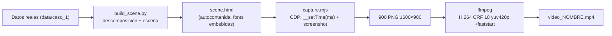

# Fase 11: Videos Deterministas por Diapositiva (Pipeline Offline + Estructura `video/`)

> **Documento de Fase:** `docs/task/fases/fase_11_videos_por_diapositiva.md`
> **Estructura de salida:** `video/seccion_{N}/diapo_{M}/video_{nombre}/` (escena + capturador + fuentes + MP4)
> **Herramientas locales:** Chromium headless (CDP) + Node ≥ 22 + ffmpeg (sin dependencias externas ni red)
> **Skill de apoyo:** `motion-design` (LottieFiles) instalada en `.opencode/skills/motion-design/`
> **Estado:** `[/] En progreso` — piloto Diapo 5 completado (18 de octubre de 2026)

---

## 1. Objetivo

Producir **videos explicativos deterministas** (repetición exacta frame a frame) para reemplazar o acompañar zonas visuales de cualquier diapositiva del deck, con todo el material fuente versionado junto al video para poder re-renderizarlo en un comando. Sin servicios externos, sin dependencias npm/pip adicionales para el render.

## 2. Arquitectura del Pipeline



- **Determinismo:** la escena expone `window.__setTime(ms)`; toda la animación es función pura del tiempo (sin `Date.now()` ni azar), por lo que dos renders del mismo `scene.html` son idénticos.
- **Recorte y estirado sin re-editar la escena:** `capture.mjs` acepta `startMs` y `timeScale`; el video final puede conservar un tramo (`[start, start + dur×scale]`) y alargarlo sin tocar los keyframes.
- **Formatos estándar:** 1920×1080 @ 30 fps (escena diseñada a 1600×900 y capturada con `dpr 1.2`), H.264 CRF 18, `yuv420p`, `+faststart` (compatible con navegador y con iframes del deck).

## 3. Estructura de Carpetas

```
video/
└── seccion_1/
    └── diapo_5/
        └── video_anatomia_senal/
            ├── build_scene.py        # datos → scene.html
            ├── scene_template.html   # diseño/animación (placeholders)
            ├── scene.html            # escena autocontenida generada
            ├── capture.mjs           # CDP → frames PNG
            ├── render.sh             # un comando: build + capture + encode
            ├── fonts/                # woff2 embebidas en la escena
            ├── anatomia_senal.mp4            # versión vigente
            └── anatomia_senal_v1_completo.mp4 # versión anterior (comparación)
```

Reglas: **ningún video vive en `docs/`**; cada video es dueño de sus fuentes; el MP4 final queda al lado de su escena, no en un directorio global.

## 4. Proceso por Video (Checklist)

1. **Brief:** diapositiva objetivo, zona a reemplazar, duración, mensaje único.
2. **Motion design:** aplicar `motion-design` (personalidad, easings direccionales, 3 capas de movimiento, regla 1/3, stagger) antes de escribir código.
3. **Escena:** `scene_template.html` + `build_scene.py` (datos reales del caso, cifras canónicas auditadas).
4. **Render:** `./render.sh` (reproducible; `ffprobe` valida 1920×1080 @ 30 fps).
5. **QA visual:** extraer keyframes del MP4 (`ffmpeg -ss …`) y revisar solapes, cifras y ritmo.
6. **Integración:** decidir reemplazo/inserción en el deck (aún no iniciada) y verificar dimensiones del panel objetivo.

## 5. Piloto: `video_anatomia_senal` (Diapo 5 — Acto 1)

- **Contenido:** descomposición ontológica con datos reales SENAMHI Punchana (2019–2025): `Y = T + S + C + ε` con la metáfora del río (cauce, marea, régimen El Niño 2023–24, entropía); récord 38.0 °C (07·10·2023); `n = 2,557`.
- **Versión vigente:** `anatomia_senal.mp4` — **entrada cinemática de 34 s** (1920×1080 @ 30 fps, 1,020 frames) pensada para reproducirse al avanzar de la Diapo 4 a la 5: cold-open con la señal real dibujándose (contador de días 2019→2025), título, ensamblaje del gráfico con cámara/polvo/grano/barridos de luz, síntesis de las 4 capas y cierre que se funde al color exacto del fondo de la Diapo 5 (`#040714`) para que la aparición de la diapositiva no tenga costura.
- **Versiones anteriores:** `anatomia_senal_v2_30s.mp4` (tramo `[2 s, 22 s]` ×1.5, 1600×900) y `anatomia_senal_v1_completo.mp4` (primer corte de 30 s), conservadas para comparación.
- **Uso previsto:** entrada de la Diapo 5; tras el video aparece la diapositiva con su explicación (integración pendiente de decisión).

## 6. Criterios de Aceptación (Fase)

- [X] `render.sh` regenera el MP4 sin intervención manual (build → captura → encode).
- [X] Reproducibilidad: `ffprobe` reporta 1920×1080, 30 fps, 1,020 frames, H.264 `yuv420p` `+faststart`.
- [X] Handoff sin costura: primer y último frame son planos del color de fondo de la Diapo 5 (`#040714`).
- [X] Cifras canónicas auditadas dentro del video (38.0 °C, 2,557 días, ±1.37 °C, σ 2.18 °C).
- [X] Estructura `video/seccion_1/diapo_5/video_anatomia_senal/` autocontenida y versionada.
- [ ] Decisión de integración en la Diapo 5 (reproducción como entrada al avanzar de la Diapo 4 a la 5) y verificación del handoff con la diapositiva real.
- [ ] Segundo video piloto en otra sección (valida que el proceso es replicable).

## 7. Tests de la Fase

- **Test de render:** `./render.sh` termina en verde y `ffprobe` confirma especificaciones (1920×1080 @ 30, 1,020 frames).
- **Test de determinismo:** dos ejecuciones consecutivas de `capture.mjs` sobre el mismo `scene.html` producen frames idénticos (mismo hash en frames comparados).
- **Test visual:** keyframes extraídos del MP4 en `t = 0.3 s`, `3.0 s`, `12.0 s`, `28.9 s`, `33.8 s` sin solapes, con cifras correctas y primer/último frame planos `#040714`.
